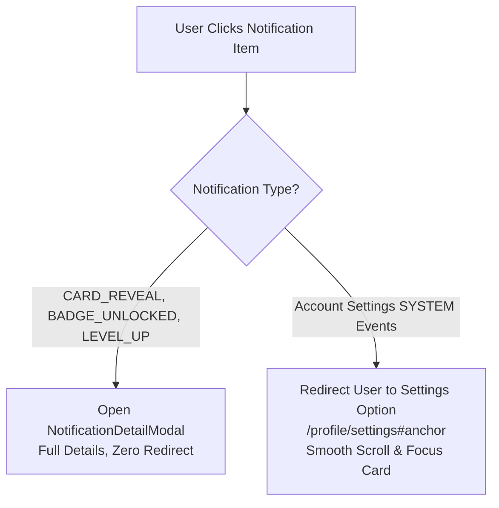
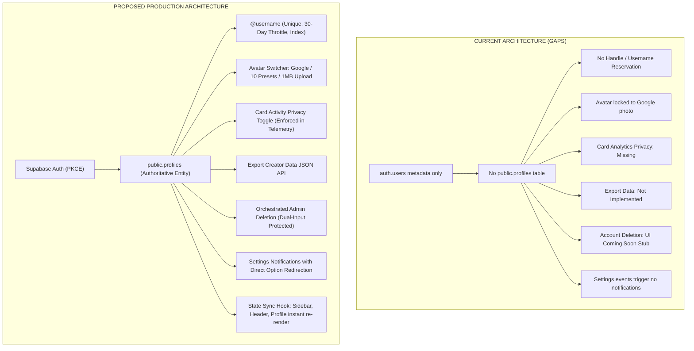
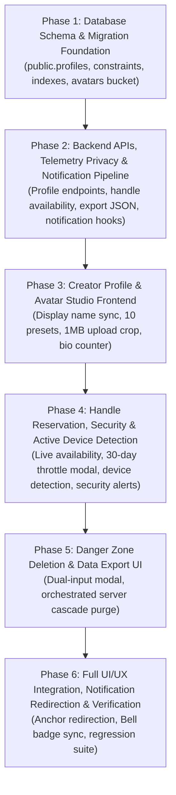

# SUPRILO — ACCOUNT SETTINGS: FINAL IMPLEMENTATION BLUEPRINT

**Document Version:** 1.3.0-PROD-BLUEPRINT  
**Target Specification:** SPEC-2C-5.8.0-ACCOUNT-SETTINGS  
**Project:** Suprilo — Scratch Card Maker  
**Canonical Document Location:** `docs/SUPRILO_ACCOUNT_SETTINGS_FINAL_IMPLEMENTATION_BLUEPRINT.md`  
**Execution Mode:** STRICT DESIGN & PLANNING ONLY  
**Implementation Authorization:** NOT GRANTED  
**Database Write Authorization:** NOT GRANTED  
**Code Modification Authorization:** NOT GRANTED  
**Migration Execution Authorization:** NOT GRANTED  
**Repository Branch:** `main` (Verified Clean)

---

## 1. EXECUTIVE SUMMARY

The Suprilo Account Settings surface (`/profile/settings`) represents the core creator identity, privacy, security, and account lifecycle management hub of the Suprilo ecosystem.

A rigorous read-only repository audit of the active codebase (`src/app/profile/settings/page.tsx`, `src/context/AuthContext.tsx`, `src/lib/auth-user.ts`, `src/components/ui/UserAvatar.tsx`, and all 7 active migrations in `supabase/migrations/`) reveals that while initial UI skeletons and Google OAuth session handshakes are active, key creator identity capabilities (unique handle reservation, 30-day throttle, avatar presets, custom uploads, analytics privacy enforcement, data export, and irreversible account deletion) currently operate as non-functional placeholders or "Coming Soon" stubs.

Per user directive, this blueprint incorporates a **pervasive notification architecture**: every account-level action, security milestone, and identity update triggers immediate multi-surface notifications (instant client toasts, authoritative in-app notification ledger records, real-time unread bell badge increments, and high-priority Web Push alerts). 

**Notification Click Navigation Rule:**
- Existing gamification and card reveal notifications (`CARD_REVEAL`, `BADGE_UNLOCKED`, `LEVEL_UP`) will continue working exactly as they do now (presenting the rich [`NotificationDetailModal`](file:///d:/My%20Projects/suprilo/src/components/notifications/NotificationDetailModal.tsx) with zero redirection).
- For **Account Settings notifications**, clicking the notification in the Notification Bell dropdown or Notification Center will **redirect the user directly to the corresponding Account Settings section/option** (`/profile/settings#[section-id]`) and smoothly focus that card.

### Core Feature Classifications Matrix

| Feature | Scope | Classification | Existing Anchor / Technical Target |
| :--- | :--- | :--- | :--- |
| **Display Name** | Editing & Propagation | `EXISTING — IMPROVE` | `src/app/profile/settings/page.tsx`, `AuthContext.tsx` |
| **Creator Handle (@username)** | Reservation & 30-Day Throttle | `NEW — IMPLEMENT NOW` | `public.profiles.username`, `chk_username_format` |
| **Creator Bio / Headline** | 100-Char Bio & Counter | `NEW — IMPLEMENT NOW` | `public.profiles.bio`, live counter |
| **Avatar Management** | Google / 10 Presets / 1MB Upload | `NEW — IMPLEMENT NOW` | `public.profiles.avatar_*`, `avatars` storage bucket |
| **Creator Meta Overview** | ID, Member Since, Level, XP | `EXISTING — PRESERVE` | `public.user_gamification_stats`, `src/app/profile/page.tsx` |
| **Device & Active Session** | OS, Browser, Active Status | `NEW — IMPLEMENT NOW` | Client User-Agent parsing & Supabase Auth session |
| **Authentication Provider** | Google OAuth Verified Notice | `EXISTING — IMPROVE` | `user.isGoogleVerified`, security notice |
| **Secure Sign Out** | Cache Flush & Route Guard | `EXISTING — IMPROVE` | `signOutUser()`, cache invalidation |
| **Export Creator Data** | JSON Archive Download | `NEW — IMPLEMENT NOW` | `GET /api/user/export-data`, cards + metrics + badges |
| **Card Activity Privacy** | Analytics Telemetry Opt-Out | `NEW — IMPLEMENT NOW` | `public.profiles.allow_card_analytics`, telemetry bypass |
| **Account Notifications** | Redirect to Settings Option | `NEW — IMPLEMENT NOW` | `public.notifications`, direct anchor navigation |
| **Danger Zone Deletion** | Dual-Input & Cascade Purge | `NEW — IMPLEMENT NOW` | `DELETE /api/user/delete-account`, admin service_role |
| **Public Creator Showcase** | `suprilo.com/@username` | `FUTURE — LOCKED` | Coming Soon visual banner only |
| **Additional Social Logins** | GitHub & Apple ID Linking | `FUTURE — LOCKED` | Coming Soon visual badge only |
| **Custom Domain Branding** | `cards.yourname.com` | `FUTURE — LOCKED` | Pro Roadmap visual badge only |
| **Deletion Email Backup** | Automated Post-Delete JSON | `FUTURE — LOCKED` | Extensible architecture hook; no email dispatch |

---

## 2. CANONICAL DOCUMENTATION RULE

> [!IMPORTANT]
> **Permanent Project Directive:** All documentation, specifications, architecture blueprints, legal checklists, and engineering plans must be committed directly to the project repository strictly inside the [`docs/`](file:///d:/My%20Projects/suprilo/docs/) folder. The repository follows `docs/` exclusively.

---

## 3. EXISTING ARCHITECTURE AUDIT

A thorough inspection of the repository reveals the current architectural foundation:

### 3.1 Frontend Architecture
- **Settings Route:** Located at [`src/app/profile/settings/page.tsx`](file:///d:/My%20Projects/suprilo/src/app/profile/settings/page.tsx). It currently renders:
  1. Profile Information card (Google avatar, Display Name edit form, read-only verified email).
  2. Profile Visibility card (static placeholder referencing `suprilo.com/@{creator}`).
  3. Security & Active Session card (static Google OAuth 2.0 and Supabase Auth badges, Sign Out button).
  4. Danger Zone card (modal displaying a "Coming Soon" notice indicating automated deletion is unavailable in Phase 3).
- **Navigation & Layout:** Built on [`src/app/profile/layout.tsx`](file:///d:/My%20Projects/suprilo/src/app/profile/layout.tsx), [`src/components/dashboard/Sidebar.tsx`](file:///d:/My%20Projects/suprilo/src/components/dashboard/Sidebar.tsx), and [`src/components/dashboard/DashboardHeader.tsx`](file:///d:/My%20Projects/suprilo/src/components/dashboard/DashboardHeader.tsx). Both the sidebar and header consume `user.displayName` and render [`src/components/ui/UserAvatar.tsx`](file:///d:/My%20Projects/suprilo/src/components/ui/UserAvatar.tsx).
- **Client Cache Layer:** [`src/lib/client/db-cache.ts`](file:///d:/My%20Projects/suprilo/src/lib/client/db-cache.ts) and [`src/lib/client/unread-notifications.ts`](file:///d:/My%20Projects/suprilo/src/lib/client/unread-notifications.ts) provide SWR-like in-memory caching for cards, badges, and notification counters.

### 3.2 Authentication & Session Architecture
- **Auth Provider:** [`src/context/AuthContext.tsx`](file:///d:/My%20Projects/suprilo/src/context/AuthContext.tsx) utilizes the browser Supabase client via PKCE popup flow, listening to `onAuthStateChange`.
- **User Normalization:** [`src/lib/auth-user.ts`](file:///d:/My%20Projects/suprilo/src/lib/auth-user.ts) maps raw Supabase `auth.users` records into `SupriloUser`, extracting `full_name`, `avatar_url`, and Google verification claims from `raw_user_meta_data`.
- **Identity Storage Gap:** There is **NO `public.profiles` or `public.users` table** in the current database schema. User identities currently exist solely in Supabase Auth's private `auth.users` table, supplemented by [`public.user_gamification_stats`](file:///d:/My%20Projects/suprilo/supabase/migrations/20261102000005_badge_system.sql#L59-L75).

### 3.3 Database Schema & Relational Dependencies
Inspecting migrations `20261102000001_core_schema.sql` through `20261107000002_performance_indexes.sql`:
- All user-owned tables reference `auth.users(id) ON DELETE CASCADE`:
  - `public.cards.user_id` -> `auth.users(id) ON DELETE CASCADE`
  - `public.user_badges.user_id` -> `auth.users(id) ON DELETE CASCADE`
  - `public.user_gamification_stats.user_id` -> `auth.users(id) ON DELETE CASCADE`
  - `public.notifications.user_id` -> `auth.users(id) ON DELETE CASCADE`
  - `public.notification_preferences.user_id` -> `auth.users(id) ON DELETE CASCADE`
  - `public.push_subscriptions.user_id` -> `auth.users(id) ON DELETE CASCADE`
- Secondary cascades:
  - `public.card_metrics.card_id` -> `public.cards(id) ON DELETE CASCADE`
  - `public.card_view_events.card_id` -> `public.cards(id) ON DELETE CASCADE`
  - `public.notification_push_deliveries` -> `notifications(id) ON DELETE CASCADE`
- Crucial Deletion Trigger:
  - [`public.process_cards_before_delete()`](file:///d:/My%20Projects/suprilo/supabase/migrations/20261102000002_functions_triggers.sql#L428-L464) fires `BEFORE DELETE ON public.cards`, automatically retiring slugs in `public.slug_registry` and queuing photo files in `public.storage_cleanup_queue`.

### 3.4 Storage Bucket Architecture
- Currently, only one storage bucket is configured: [`card-photos`](file:///d:/My%20Projects/suprilo/supabase/migrations/20261102000004_storage_policies.sql#L12-L24) (private, 2MB limit, restricted to JPEG, PNG, WEBP).
- No `avatars` bucket exists in the database.

---

## 4. EXISTING WORKING FUNCTIONALITY INVENTORY

The following systems are verified as fully operational and **must be preserved without architectural disturbance**:

1. **Creator Meta & Gamification Progression:**
   - Source: `public.user_gamification_stats` and [`src/types/badges.ts`](file:///d:/My%20Projects/suprilo/src/types/badges.ts).
   - Metrics: Creator Level (1–10), Total XP, Member Since (`user.metadata.creationTime`), Last Active timestamp.
   - Behavior: Cleanly rendered in `/profile` and must be presented in the redesigned Account Settings overview card without altering data fetching or calculation logic.
2. **Google OAuth PKCE Authentication:**
   - Source: `src/context/AuthContext.tsx` via `signInWithGoogle(returnUrl)` and `/auth/callback/route.ts`.
   - Behavior: Popup authentication prevents browser history pollution; verified Google email status is maintained.
3. **Card Lifecycle & Concurrency Slots:**
   - Source: `public.cards`, `create_card_draft`, `publish_card_draft`, draft limits (max 3 drafts).
   - Behavior: Preserved intact; unaffected by account settings changes.
4. **Notification Preferences & Push Subscriptions:**
   - Source: `public.notification_preferences`, `public.push_subscriptions`, `/profile/notifications`.
   - Behavior: Notification settings are managed exclusively in `/profile/notifications`; no duplicate toggles in Account Settings.
5. **Gamification Detail Modals:**
   - Source: [`NotificationDetailModal`](file:///d:/My%20Projects/suprilo/src/components/notifications/NotificationDetailModal.tsx).
   - Behavior: Clicking `CARD_REVEAL`, `BADGE_UNLOCKED`, and `LEVEL_UP` notifications continues to open the rich detail modal with zero redirection.

---

## 5. FEATURE-BY-FEATURE IMPLEMENTATION ANALYSIS

### Section A: Creator Profile & Identity

#### A1. Display Name Editing & Application-Wide Propagation
- **Classification:** `EXISTING — IMPROVE`
- **Current Behavior:** Calls `supabase.auth.updateUser({ data: { full_name: displayName.trim() } })`. It updates `auth.users.raw_user_meta_data`, but does not guarantee instant local state synchronization across the Studio Sidebar and Dashboard Header without delay.
- **Target Implementation:**
  - Persist to both `auth.users` metadata and the proposed `public.profiles.display_name`.
  - Expose an `updateUserMetadata` helper in `AuthContext.tsx` that updates the in-memory `user` state immediately upon successful Supabase resolution.
  - Sidebar ([`Sidebar.tsx`](file:///d:/My%20Projects/suprilo/src/components/dashboard/Sidebar.tsx#L124)) and Header ([`DashboardHeader.tsx`](file:///d:/My%20Projects/suprilo/src/components/dashboard/DashboardHeader.tsx#L63)) automatically re-render without page refresh.
  - Validation: 1 to 50 characters, trimmed, required.
  - **Notification Coverage:**
    - Toast: *"Display name updated to [Name]"*.
    - In-App Notification: *"Display Name Updated: Your public creator name is now [Name]"* with destination URL `/profile/settings#profile-identity`.
    - Push Notification: High-priority identity alert if push is enabled.

#### A2. Creator Handle (@username) Reservation & 30-Day Throttle
- **Classification:** `NEW — IMPLEMENT NOW`
- **Default Generation Strategy:**
  - Extract email prefix (e.g. `adarshmishra7030@...` -> `adarshm`).
  - Sanitize characters (`[^a-zA-Z0-9_]`).
  - Ensure length 3–20 characters. If `< 3` chars, prefix with `creator_`.
  - Verify database uniqueness. If taken, append random 3-digit number (e.g. `adarshm_482`).
- **Validation Rules:**
  - Length: 3 to 20 characters.
  - Characters: alphanumeric and underscores only (`^[a-zA-Z0-9_]{3,20}$`). No spaces, no hyphens, no symbols.
  - Case-insensitive uniqueness enforced via database constraint `UNIQUE (LOWER(username))`.
  - Reserved system usernames rejected: `admin`, `api`, `suprilo`, `support`, `settings`, `profile`, `card`, `auth`, `null`, `undefined`, `help`, `billing`, `root`, `studio`, `create`, `system`, `legal`, `terms`, `privacy`, `explore`.
- **Form Input & Interaction Architecture (Senior Dev Standard):**
  - **Locked Cooldown State (30-Day Limit Active):** When `!eligibility.canChange`, the input displays the user's active registered username in **disabled read-only format** with an inline `Locked` indicator. The generic placeholder is suppressed so the user clearly sees their confirmed handle throughout the 30-day cooldown period.
  - **Eligible State (Ready to Change / Initial Setup):** When `eligibility.canChange` is true, the input starts blank with `placeholder="e.g. bob"`, allowing creators to directly click and type without backspacing existing text.
  - **Single Focused Action:** Presents a single, high-contrast `"Reserve Handle"` button without cluttering secondary controls.
  - **Live Availability Checking:** Debounced (350ms) client lookup against `GET /api/user/check-username?username=...`. Activates when typing a new candidate handle.
  - **Strict Status Badges & Error Differentiation:**
    - `Available` (Emerald): The handle is valid and available for reservation.
    - `Taken` (Rose): **ONLY displayed when the candidate handle is already claimed by another creator in the database.**
    - `Invalid` (Amber): Displayed when the input violates validation rules (fewer than 3 characters, invalid characters, spaces, or platform reserved handles). Short inputs (e.g. 1 or 2 characters) explicitly display **`Invalid`**, never `Taken`.
    - `Checking...` (Brand Warm): Real-time spinner during network lookups.
- **30-Day Change Restriction & Lock Modal:**
  - Tracked via `public.profiles.username_updated_at`.
  - Server-side validation: If `now() - username_updated_at < interval '30 days'`, reject update with `403 Forbidden` and return the exact `nextEligibleDate`.
  - Confirmation Modal: Before persisting, an explicit confirmation dialog compares `@current` with `@new` and enforces the commitment: *"Changing your handle to @[username] will lock it for 30 days. You will not be able to change it again until [Formatted Date]. Do you want to proceed?"*
  - On failure, previous username remains intact.
- **Future Purpose Indicator:**
  - Tasteful roadmap preview: *"Public Showcase URL (Coming Soon): https://suprilo.com/@[username]"*.
  - Public profile routes (`/@username`) remain locked and NOT implemented.
- **Notification Coverage:**
  - Toast: *"Handle @[username] successfully reserved!"*
  - In-App Notification: *"Creator Handle Reserved: Your handle @[username] is active. Locked for 30 days until [Date]."* with destination URL `/profile/settings#creator-handle`.
  - Push Notification: Instant confirmation alert on connected devices.

#### A3. Creator Bio / Headline
- **Classification:** `NEW — IMPLEMENT NOW`
- **Default Happiness Quote for New Creators:**
  - Every new user account is automatically initialized with the brand happiness quote:
    `"Here to celebrate life, share smiles, and make every moment special ✨"` (70 chars, well within the 100-character ceiling).
  - Defined as authoritative constant `DEFAULT_CREATOR_BIO` in `src/types/profile.ts`.
  - Profile resolvers (`src/lib/server/profile.ts`, `src/lib/auth-user.ts`) fall back to `DEFAULT_CREATOR_BIO` if no custom bio is set.
  - Displayed on the user profile (`src/app/profile/page.tsx`) with strict text wrapping rules (`break-words [overflow-wrap:anywhere] [word-break:break-word]`) preventing layout clipping on mobile.
- **Account Settings Editing & Counter:**
  - Textarea pre-populated with current bio (or default happiness quote for new creators) with live counter (`[X] / 100`).
  - Maximum 100 characters enforced by database check constraint (`chk_profiles_bio`) and client validation.
  - Placeholder displays `DEFAULT_CREATOR_BIO` as inspiration if cleared.
- **Dynamic Contextual Green Feedback Banner:**
  - Distinct banner title and message based on the exact fields updated:
    - Display Name only: Title `"Display Name Saved!"`, Message: `"Display name successfully updated."`
    - Bio only: Title `"Bio Saved!"`, Message: `"Creator bio successfully updated."`
    - Both Display Name & Bio: Title `"Identity Saved!"`, Message: `"Display name and creator bio were successfully updated."`
- **Notification Coverage:**
  - Toast: *"Creator bio saved successfully."*
  - In-App Notification: *"Profile Bio Updated: Your creator bio has been updated."* with destination URL `/profile/settings#profile-identity`.

#### A4. Avatar Management Architecture
- **Classification:** `NEW — IMPLEMENT NOW`
- **Sources & Rules:**
  1. **Google Profile Photo:** Initial default on account creation.
  2. **Platform Preset Avatars:** Exactly 10 stylish, consistent illustrated SVG/WebP assets placed in `/public/avatars/presets/`:
     - 3 adult male (`preset-male-1`, `preset-male-2`, `preset-male-3`)
     - 3 adult female (`preset-female-1`, `preset-female-2`, `preset-female-3`)
     - 1 girl (`preset-girl-1`)
     - 1 boy (`preset-boy-1`)
     - 1 older man (`preset-elder-male-1`)
     - 1 older woman (`preset-elder-female-1`)
  3. **Custom Upload:**
     - Maximum file size: 1 MB (`1,048,576 bytes`).
     - Allowed MIME types: `image/jpeg`, `image/png`, `image/webp`.
     - Reject SVG, GIF, executables, scripts.
     - Dimension limits: Minimum 128x128px, maximum 1024x1024px.
     - Client-side square crop preview modal with canvas aspect-ratio lock.
     - Upload storage path: `avatars/{user_id}/avatar_{timestamp}.webp`.
- **Permanent Override Rule:**
  - Selecting a preset or uploading a custom avatar sets `public.profiles.avatar_source = 'manual'`.
  - Subsequent Google OAuth logins check `avatar_source`: if `'manual'`, the Google profile photo is **never** re-synced or overwritten.
- **Storage Cleanup:**
  - When replacing a custom avatar, the previous custom avatar storage object is enqueued into `public.storage_cleanup_queue` to prevent orphaned assets.
- **Notification Coverage:**
  - Toast: *"Profile photo updated successfully."*
  - In-App Notification: *"Avatar Changed: Your creator avatar was updated."* with destination URL `/profile/settings#avatar-studio`.

---

### Section B: Creator Meta & Account Overview
- **Classification:** `EXISTING — PRESERVE`
- **Implementation Strategy:**
  - Display Creator ID (with 1-click copy to clipboard and toast feedback: *"Creator ID copied to clipboard"*).
  - Display Member Since (`user.metadata.creationTime`).
  - Display Creator Level & Gamification Tier (e.g., Level 1 • Novice Crafter).
  - Display Total Earned XP.
  - Retain existing data sources from `public.user_gamification_stats` and `src/types/badges.ts`.

---

### Section C: Security, Device & Active Session

#### C1. Current Device & Active Session
- **Classification:** `NEW — IMPLEMENT NOW`
- **Implementation:** Parse client-side `navigator.userAgent` using a lightweight parser utility:
  - OS Detection: Windows, macOS, Linux, iOS, Android.
  - Browser Detection: Chrome, Safari, Firefox, Edge, Brave.
  - Status indicator: Green pulse dot with *"Active Now"*.
  - Session security badge: Supabase Auth Session (JWT with PKCE verification).
- **Security Notification:**
  - On new session detection: In-app notification & push alert: *"Security Alert: New Sign-In from [OS] ([Browser])."* with destination URL `/profile/settings#security-session`.

#### C2. Connected Authentication Provider
- **Classification:** `EXISTING — IMPROVE`
- **Implementation:**
  - Google OAuth 2.0 provider badge with verified checkmark.
  - Read-only associated email address (`user.email`).
  - Security Notice: *"Your authentication credentials, password security, and two-factor authentication are securely managed by Google. Suprilo never stores or processes your Google account password."*

#### C3. Secure Sign Out
- **Classification:** `EXISTING — IMPROVE`
- **Implementation:**
  - Invoke `supabase.auth.signOut()`.
  - Invalidate and purge all client-side cache stores: `db-cache.ts` in-memory map, unread notification counter, and browser storage tokens.
  - Clear auth state in `AuthContext.tsx`.
  - Perform hard redirect to `/` to ensure protected routes immediately reject access.

---

### Section D: Data & Privacy

#### D1. Export Creator Data (JSON Backup)
- **Classification:** `NEW — IMPLEMENT NOW`
- **Implementation:**
  - Server route: `GET /api/user/export-data`.
  - Authenticated session verification via Supabase Server Client (`auth.getUser()`).
  - Aggregates user-owned records:
    1. Creator Profile: `display_name`, `username`, `bio`, `avatar_url`, `created_at`.
    2. Gamification: `total_xp`, `current_level`, badges unlocked with timestamps and points.
    3. Created Cards: `id`, `slug`, `recipient_name`, `status`, `occasion_tag`, `foil_style`, `bg_palette`, `created_at`, `published_at`.
    4. Card Metrics: `views_count`, `reveals_count` per card.
    5. Notification Preferences: active settings.
  - Streams formatted JSON attachment: `suprilo-creator-data-[YYYY-MM-DD].json`.
  - UI shows progress state, instant browser download trigger, and error handling.
- **Notification Coverage:**
  - Toast: *"Creator data exported successfully."*
  - In-App Notification: *"Creator Data Exported: A full JSON backup archive was generated and downloaded on [Date]."* with destination URL `/profile/settings#data-privacy`.

#### D2. Card Activity Privacy Enforcement
- **Classification:** `NEW — IMPLEMENT NOW`
- **Setting:** *"Allow analytics collection on my shared surprise cards"* (Default: Enabled).
- **Storage:** Persisted in `public.profiles.allow_card_analytics boolean NOT NULL DEFAULT true`.
- **Enforcement Pipeline:**
  1. [`/api/telemetry/handshake/route.ts`](file:///d:/My%20Projects/suprilo/src/app/api/telemetry/handshake/route.ts): When a recipient opens a card, the route resolves the creator's `allow_card_analytics` preference. If `false`, returns `is_untracked: true` and skips recording view telemetry.
  2. [`/api/telemetry/reveal/route.ts`](file:///d:/My%20Projects/suprilo/src/app/api/telemetry/reveal/route.ts): When a card is scratched, checks the creator's privacy setting. If `false`, bypasses `record_card_telemetry` and counter increments.
  3. Database RPCs: `record_card_telemetry` and `record_card_view_handshake` evaluate the card owner's privacy flag before incrementing `views_count` or `reveals_count`.
- **Notification Coverage:**
  - Toast: *"Card analytics privacy preference updated."*
  - In-App Notification: *"Privacy Updated: Card analytics collection is now [Enabled/Disabled]."* with destination URL `/profile/settings#data-privacy`.

---

### Section E: Danger Zone — Permanent Account Deletion

#### E1. Dual-Input Account Deletion Confirmation
- **Classification:** `NEW — IMPLEMENT NOW`
- **Modal Mechanics:**
  - Input 1: Exact current `displayName` (case-sensitive check against authoritative user state).
  - Input 2: Literal confirmation text `DELETE` (uppercase).
  - Button state: Permanently disabled until both fields strictly match.

#### E2. Irreversible Account Deletion Orchestration
- **Classification:** `NEW — IMPLEMENT NOW`
- **Backend Route:** `DELETE /api/user/delete-account`.
- **Execution Mechanism:** Uses `getSupabaseAdminClient()` (`service_role` key, strictly server-side).
- **Execution Sequence:**
  ```mermaid
  sequenceDiagram
    autonumber
    actor User as Authenticated Client
    participant API as /api/user/delete-account
    participant Storage as Supabase Storage
    participant DB as PostgreSQL (Supabase)
    participant Auth as Supabase Auth Admin

    User->>API: DELETE (Bearer Session + Confirmations)
    API->>API: Verify session & validate dual confirmations
    API->>Storage: List & purge user objects (card-photos/{uid}/*, avatars/{uid}/*)
    API->>DB: Delete from public.cards (Fires before_delete trigger to retire slugs)
    API->>DB: Delete from public.user_gamification_stats & user_badges
    API->>DB: Delete from public.notifications & push_subscriptions
    API->>DB: Delete from public.profiles
    API->>Auth: supabaseAdmin.auth.admin.deleteUser(uid)
    API-->>User: 200 OK { success: true }
    User->>User: Clear local cookies, cache, and redirect to "/"
  ```
- **Partial Failure Handling:**
  - Database operations leverage transactional cascading foreign keys where possible.
  - If Storage deletion experiences network timeout, remaining records are logged to `public.storage_cleanup_queue` so background workers can complete asset purging.
  - The client session is terminated only after `auth.admin.deleteUser()` succeeds.

#### E3. Post-Deletion Email Backup Hook
- **Classification:** `FUTURE — LOCKED`
- Architecture provides an extensible event stub for future email delivery, but **no email generation, dispatch, or promises are made in the current release**.

---

## 6. PERVASIVE ACCOUNT NOTIFICATION & REDIRECTION ARCHITECTURE

To maximize creator awareness, security transparency, and navigation convenience, every action in Account Settings triggers notifications across all available layers.

### 6.1 Dual Click-Navigation Handling



1. **Gamification & Scratch Notifications (`CARD_REVEAL`, `BADGE_UNLOCKED`, `LEVEL_UP`):**
   - Click behavior remains **as currently working**: opens [`NotificationDetailModal`](file:///d:/My%20Projects/suprilo/src/components/notifications/NotificationDetailModal.tsx) with complete statistics, dates, points, and a clean close button without navigating away.
2. **Account Settings Notifications (`SYSTEM` with `url: "/profile/settings#..."`):**
   - Click behavior: **Redirects the user directly to the targeted Account Settings option**.
   - Closes the Bell dropdown, invokes `router.push(item.metadata.url)`, and automatically scrolls to the designated section.

### 6.2 Action-to-Notification & Destination Anchor Mapping

| Account Action | In-App Title & Body | Destination URL (Click Redirection) | Push Eligible? |
| :--- | :--- | :--- | :--- |
| **Display Name Updated** | Title: `Display Name Updated`<br>Body: `Your creator name was changed to "${newName}".` | `/profile/settings#profile-identity` | **Yes** (Identity alert) |
| **Handle Reserved** | Title: `Creator Handle Reserved`<br>Body: `Handle @${handle} is active. Next change allowed after 30 days.` | `/profile/settings#creator-handle` | **Yes** (Milestone) |
| **Bio Saved** | Title: `Profile Bio Updated`<br>Body: `Your creator bio was successfully saved.` | `/profile/settings#profile-identity` | **No** (In-app only) |
| **Avatar Changed** | Title: `Avatar Changed`<br>Body: `Your creator profile photo was updated.` | `/profile/settings#avatar-studio` | **No** (In-app only) |
| **Data Exported** | Title: `Creator Data Exported`<br>Body: `A JSON backup containing your cards, metrics, and badges was generated.` | `/profile/settings#data-privacy` | **No** (In-app only) |
| **Privacy Toggled** | Title: `Card Privacy Updated`<br>Body: `Card analytics collection is now ${enabled ? 'active' : 'disabled'}.` | `/profile/settings#data-privacy` | **No** (In-app only) |
| **New Session / Login** | Title: `Security Alert: New Sign-In`<br>Body: `Signed in from ${os} using ${browser}.` | `/profile/settings#security-session` | **Yes** (Security notice) |

### 6.3 Implementation in Click Handlers:
In [`NotificationBell.tsx`](file:///d:/My%20Projects/suprilo/src/components/notifications/NotificationBell.tsx) and [`/profile/notifications/page.tsx`](file:///d:/My%20Projects/suprilo/src/app/profile/notifications/page.tsx):
```ts
const handleItemClick = async (item: NotificationItem) => {
  // 1. Mark as read optimistically and on server
  markNotificationAsRead(item.id);

  // 2. Check destination routing
  const targetUrl = (item.metadata?.url as string) || item.action_url;
  if (targetUrl && targetUrl.startsWith("/profile/settings")) {
    setIsOpen(false);
    router.push(targetUrl);
    return;
  }

  // 3. Fallback for Gamification (Badge, Level, Reveal): Open rich detail modal
  setSelectedNotification(item);
  setIsDetailModalOpen(true);
};
```

---

## 7. CURRENT VS. PROPOSED ARCHITECTURE



---

## 8. DATABASE CHANGES (PROPOSED SCHEMA)

### 8.1 Proposed Migration: `public.profiles` Table
```sql
-- Migration: 20261109000001_creator_profiles.sql
-- Description: Creator profile identity, unique handle reservation, avatar management, and analytics privacy.

CREATE TABLE IF NOT EXISTS public.profiles (
  user_id uuid PRIMARY KEY REFERENCES auth.users(id) ON DELETE CASCADE,
  username text NOT NULL
    CONSTRAINT chk_profiles_username_format CHECK (username ~ '^[a-zA-Z0-9_]{3,20}$'),
  username_updated_at timestamptz NULL,
  display_name text NOT NULL
    CONSTRAINT chk_profiles_display_name CHECK (char_length(trim(display_name)) BETWEEN 1 AND 50),
  bio text NULL
    CONSTRAINT chk_profiles_bio CHECK (bio IS NULL OR char_length(bio) <= 100),
  avatar_type text NOT NULL DEFAULT 'google'
    CONSTRAINT chk_profiles_avatar_type CHECK (avatar_type IN ('google', 'preset', 'custom')),
  avatar_preset_id text NULL
    CONSTRAINT chk_profiles_avatar_preset CHECK (
      avatar_preset_id IS NULL OR avatar_preset_id IN (
        'preset-male-1', 'preset-male-2', 'preset-male-3',
        'preset-female-1', 'preset-female-2', 'preset-female-3',
        'preset-girl-1', 'preset-boy-1',
        'preset-elder-male-1', 'preset-elder-female-1'
      )
    ),
  custom_avatar_url text NULL,
  avatar_source text NOT NULL DEFAULT 'google'
    CONSTRAINT chk_profiles_avatar_source CHECK (avatar_source IN ('google', 'manual')),
  allow_card_analytics boolean NOT NULL DEFAULT true,
  created_at timestamptz NOT NULL DEFAULT clock_timestamp(),
  updated_at timestamptz NOT NULL DEFAULT clock_timestamp()
);

-- Case-insensitive unique handle index
CREATE UNIQUE INDEX IF NOT EXISTS idx_profiles_username_lower
  ON public.profiles (LOWER(username));

-- Lookup performance index
CREATE INDEX IF NOT EXISTS idx_profiles_user_id
  ON public.profiles (user_id);
```

### 8.2 Proposed Migration: Storage Bucket `avatars`
```sql
-- Migration: 20261109000002_avatar_storage.sql
-- Description: Dedicated public-read avatar bucket with owner-only write policies.

INSERT INTO storage.buckets (id, name, public, file_size_limit, allowed_mime_types)
VALUES (
  'avatars',
  'avatars',
  true,
  1048576, -- 1MB
  ARRAY['image/jpeg', 'image/png', 'image/webp']
)
ON CONFLICT (id) DO UPDATE SET
  public = true,
  file_size_limit = 1048576,
  allowed_mime_types = ARRAY['image/jpeg', 'image/png', 'image/webp'];

-- Storage Object RLS Policies for avatars
CREATE POLICY "avatars_public_read"
  ON storage.objects FOR SELECT
  USING (bucket_id = 'avatars');

CREATE POLICY "avatars_owner_insert"
  ON storage.objects FOR INSERT
  TO authenticated
  WITH CHECK (
    bucket_id = 'avatars' AND
    (storage.foldername(name))[1] = auth.uid()::text
  );

CREATE POLICY "avatars_owner_update"
  ON storage.objects FOR UPDATE
  TO authenticated
  USING (
    bucket_id = 'avatars' AND
    (storage.foldername(name))[1] = auth.uid()::text
  );

CREATE POLICY "avatars_owner_delete"
  ON storage.objects FOR DELETE
  TO authenticated
  USING (
    bucket_id = 'avatars' AND
    (storage.foldername(name))[1] = auth.uid()::text
  );
```

---

## 9. RLS & SECURITY STRATEGY

1. **`public.profiles` RLS Policies:**
   - `SELECT`: Authenticated users can view their own profile (`auth.uid() = user_id`).
   - `UPDATE`: Authenticated users can only update their own profile (`auth.uid() = user_id`).
   - `INSERT`: Controlled via authenticated RPC or trigger on `auth.users`.
2. **Server-Side Validation Boundaries:**
   - 30-day username throttle enforced strictly in backend RPC/API route (`now() - username_updated_at >= interval '30 days'`).
   - Account deletion requires authoritative session validation and dual string matching.
   - Administrative operations strictly run through `getSupabaseAdminClient()` on the Node.js server runtime; service-role keys are never exposed to the browser.
3. **Storage Security:**
   - File uploads validated for both extension and binary MIME types.
   - File paths bound strictly to `{user_id}/{filename}` to prevent path traversal.

---

## 10. BACKEND / API / EDGE FUNCTION REQUIREMENTS

| Route / RPC | Method / Type | Security Scope | Purpose |
| :--- | :--- | :--- | :--- |
| `GET /api/user/profile` | Next.js Route | Authenticated User | Fetch authoritative profile record |
| `PATCH /api/user/profile` | Next.js Route | Authenticated User | Update display name, bio, avatar preference |
| `GET /api/user/check-username` | Next.js Route | Authenticated User | Debounced real-time handle availability check |
| `POST /api/user/update-username`| Next.js Route | Authenticated User | Handle reservation with 30-day throttle check |
| `PATCH /api/user/privacy` | Next.js Route | Authenticated User | Toggle `allow_card_analytics` setting |
| `GET /api/user/export-data` | Next.js Route | Authenticated User | Stream structured JSON creator data archive |
| `DELETE /api/user/delete-account`| Next.js Route | Authenticated User | Orchestrated permanent account deletion |

---

## 11. FRONTEND COMPONENT ARCHITECTURE

```
src/
├── app/
│   └── profile/
│       └── settings/
│           ├── page.tsx                     (Main orchestrator & layout with section anchors)
│           └── loading.tsx                  (Skeleton loader)
├── components/
│   └── settings/
│       ├── CreatorMetaOverviewCard.tsx      (Preserved Level, XP, Member Since, ID)
│       ├── ProfileIdentityCard.tsx          (id="profile-identity": Display Name, Bio with live counter)
│       ├── UsernameReservationCard.tsx      (id="creator-handle": Handle reservation, live check, 30-day throttle)
│       ├── AvatarStudioCard.tsx             (id="avatar-studio": Google vs 10 Presets vs 1MB Upload)
│       ├── AvatarCropModal.tsx              (Square crop preview with canvas export)
│       ├── SecuritySessionCard.tsx          (id="security-session": OS, Browser, Active Status, Google Auth)
│       ├── DataPrivacyCard.tsx              (id="data-privacy": Export JSON button, Analytics toggle)
│       ├── DangerZoneCard.tsx               (id="danger-zone": Destructive action trigger)
│       └── DeleteAccountConfirmModal.tsx    (Dual-input exact match confirmation)
```

### 11.1 Section Header & Badge Alignment Standards
To ensure consistent visual balance and prevent badges from pushing to card edges or splitting awkwardly:
- **Heading Wrap & Badge Proximity:** Every card heading uses `inline-flex flex-wrap items-center gap-x-2.5 gap-y-1`.
- **Badge Stability:** Every section status badge uses `whitespace-nowrap shrink-0` with standard pill padding (`px-2.5 py-0.5 rounded-full text-[10px] font-bold uppercase tracking-wider`).
- **Typography & Word Spacing:** Card titles employ `tracking-normal` rather than aggressive `tracking-tight` to preserve clear word legibility across responsive widths.

---

## 12. STATE SYNCHRONIZATION STRATEGY

To fulfill the requirement that **display name and avatar updates propagate throughout the application (Studio Sidebar, Header, Profile) immediately without a page refresh**:

1. **Auth Context Expansion:** In [`src/context/AuthContext.tsx`](file:///d:/My%20Projects/suprilo/src/context/AuthContext.tsx), introduce an authoritative `refreshUser()` and `setOptimisticProfile({ displayName, photoURL })` callback.
2. **Optimistic UI Updates:** When the user clicks "Save" on display name or selects a new avatar:
   - Client updates local state immediately.
   - `AuthContext` user reference updates.
   - [`Sidebar.tsx`](file:///d:/My%20Projects/suprilo/src/components/dashboard/Sidebar.tsx#L124) and [`DashboardHeader.tsx`](file:///d:/My%20Projects/suprilo/src/components/dashboard/DashboardHeader.tsx#L63) immediately reflect the new name and image.
3. **Cross-Tab Synchronization:** Supabase Auth `onAuthStateChange` broadcasts across browser tabs via BroadcastChannel.

---

## 13. STORAGE & AVATAR HANDLING

```mermaid
flowchart LR
  A[Avatar Source] --> B{Source Type?}
  B -->|Google| C[Initial Google OAuth Photo]
  B -->|Preset| D[Select 1 of 10 Local SVG/WebP Presets]
  B -->|Upload| E[Client Crop 128x128..1024x1024]
  E --> F[Validate <= 1MB, JPEG/PNG/WebP]
  F --> G[Upload to avatars/{user_id}/avatar_{timestamp}.webp]
  D --> H[Set avatar_source = manual]
  G --> H
  H --> I[Permanently Disable Google Photo Overwrite]
```

---

## 14. ANALYTICS PRIVACY ENFORCEMENT

When `allow_card_analytics` is set to `false`:
1. **Telemetry Handshake:** [`/api/telemetry/handshake/route.ts`](file:///d:/My%20Projects/suprilo/src/app/api/telemetry/handshake/route.ts) resolves the card creator's preference. If disabled, it returns `is_untracked: true` and skips incrementing view telemetry.
2. **Scratch Reveal:** [`/api/telemetry/reveal/route.ts`](file:///d:/My%20Projects/suprilo/src/app/api/telemetry/reveal/route.ts) skips incrementing `reveals_count` in `card_metrics`.
3. **Recipient Experience Unaffected:** The surprise card scratch and reveal animations function smoothly without disruption.

---

## 15. DATA EXPORT ARCHITECTURE

1. Request: `GET /api/user/export-data` with authenticated session.
2. Backend queries:
   - `auth.users` & `public.profiles` for creator info.
   - `public.cards` & `public.card_metrics` for cards, messages, foil styles, views, and reveals.
   - `public.user_badges` & `public.badges` for achievement history.
   - `public.user_gamification_stats` for XP and level progress.
3. Returns:
   ```json
   {
     "exported_at": "2026-11-09T00:00:00.000Z",
     "creator": {
       "id": "uuid",
       "displayName": "Adarsh Mishra",
       "username": "adarshm",
       "bio": "Crafting magical scratch moments",
       "email": "user@example.com",
       "memberSince": "2026-10-25T12:00:00.000Z"
     },
     "gamification": {
       "level": 3,
       "total_xp": 1450,
       "badges": [...]
     },
     "cards": [...]
   }
   ```

---

## 16. PERMANENT ACCOUNT DELETION ARCHITECTURE

### Deletion Protocol:
1. **Authentication Verification:** Caller must present active JWT session matching the deletion target.
2. **Dual-Input Validation:**
   - Input 1 must match `user.displayName`.
   - Input 2 must match `DELETE`.
3. **Execution Pipeline (Server Admin via `service_role`):**
   - Delete user storage objects in `card-photos/{user_id}/` and `avatars/{user_id}/`.
   - Delete `public.cards` (trigger `trg_cards_before_delete` retires slugs in `slug_registry`).
   - Cascade delete `user_badges`, `user_gamification_stats`, `notifications`, `push_subscriptions`, `profiles`.
   - Delete `auth.users` record via `supabaseAdmin.auth.admin.deleteUser(user.id)`.
   - Terminate client session and redirect to `/`.

---

## 17. UI / UX REDESIGN SPECIFICATION

The redesigned Account Settings page adheres to the Suprilo Design System:
- **Palette:** Soft ivory backgrounds (`bg-brand-warm-subtle`), crisp white cards (`bg-white`), warm borders (`border-brand-warm-border`), coral-pink brand accents (`from-brand-pink to-brand-orange`).
- **Typography:** Bold tracking-tight headings, legible subtext, uppercase category tags.
- **Card Organization & Anchors:**
  1. *Creator Meta & Identity Overview* (`#creator-meta` — Preserved stats + copyable Creator ID).
  2. *Creator Profile & Identity* (`#profile-identity` — Display name, bio with character counter).
  3. *Creator Handle Reservation* (`#creator-handle` — @username input, live availability badge, 30-day throttle notice, Coming Soon showcase banner).
  4. *Avatar Studio* (`#avatar-studio` — Avatar preview, 10 presets, custom 1MB upload crop).
  5. *Security & Active Session* (`#security-session` — Google OAuth verified badge, current device/browser detection, active status dot, sign out).
  6. *Data & Privacy Center* (`#data-privacy` — Export JSON backup button, Card Activity Privacy switch).
  7. *Danger Zone* (`#danger-zone` — Contrasting subtle rose background, permanent deletion modal trigger).

---

## 18. FUTURE LOCKED FEATURES SPECIFICATION

| Feature | Visual Presentation | Functional Restriction |
| :--- | :--- | :--- |
| **Public Creator Showcase** (`suprilo.com/@username`) | Amber badge: *"Coming Soon"* + explanatory note | No public routing or profile page rendering |
| **Connected Accounts** (GitHub, Apple ID) | Slate badge: *"Coming Soon"* + provider icons | No OAuth linking flows or provider bindings |
| **Custom Domain Branding** (`cards.yourname.com`) | Purple badge: *"Pro Feature / Roadmap"* | No DNS verification or domain mapping |
| **Post-Deletion Data Email** | Internal architectural hook only | No email dispatch or delivery promises to users |

---

## 19. DEPENDENCY-AWARE IMPLEMENTATION PHASES



---

## 20. TESTING STRATEGY

1. **Unit & Validation Tests:**
   - Username regex matching: accept `john_doe1`, reject `john doe`, `john@doe`, `ab`, 21-char string.
   - Bio length boundary: accept 100 chars, reject 101 chars.
   - Dual-input deletion: reject trailing spaces, reject lowercase `delete`.
2. **Integration Tests:**
   - 30-Day username throttle: verify rejection within 30 days and acceptance after 31 days.
   - Avatar permanent override: confirm Google OAuth login does NOT overwrite a manual avatar.
   - Analytics privacy: verify card view/reveal increments when enabled and halts when disabled.
   - Notification redirection: verify clicking settings notifications navigates to `/profile/settings#[anchor]` while clicking gamification notifications opens the detail modal.
3. **Security & RLS Tests:**
   - Attempt updating another user's profile via direct PostgREST call (must return 403/0 rows).
   - Attempt uploading custom avatar to another user's folder in `avatars` bucket (must return 403).
   - Verify unauthenticated export attempts return 401.

---

## 21. FEATURE ACCEPTANCE CRITERIA

- [ ] **Display Name:** Changes propagate immediately to Studio Sidebar, Header, and Profile without page reload; triggers toast and in-app notification linking to `#profile-identity`.
- [ ] **Handle Reservation:** Handles adhere to `^[a-zA-Z0-9_]{3,20}$`, lowercase unique index prevents collisions, and real-time availability updates reliably; triggers notification linking to `#creator-handle`.
- [ ] **30-Day Throttle:** Attempting a second username change within 30 days is rejected with the exact next eligible date.
- [ ] **Bio Counter:** Live counter tracks input up to 100 characters; values > 100 are blocked.
- [ ] **Avatar Presets:** All 10 presets render sharply and save successfully.
- [ ] **Custom Upload:** Files > 1MB or invalid MIME types are rejected; valid images are cropped to square and uploaded to `avatars/{user_id}/`.
- [ ] **Google Override:** Manually set avatars are not overwritten on subsequent Google logins.
- [ ] **Data Export:** Clicking "Export Creator Data" triggers an immediate download of valid, complete creator JSON and issues a notification linking to `#data-privacy`.
- [ ] **Privacy Enforcement:** Disabling card activity privacy halts telemetry increments while preserving card reveal functionality.
- [ ] **Notification Redirection:** Clicking an account settings notification navigates directly to `/profile/settings#[section-id]`, while reveal and gamification notifications open the detail modal without redirection.
- [ ] **Permanent Deletion:** Requires exact display name + `DELETE`; purges all storage assets, cards, gamification, and auth records safely.

---

## 22. RISKS & MITIGATION STRATEGIES

| Risk | Impact | Mitigation Strategy |
| :--- | :--- | :--- |
| **Race condition in handle reservation** | High (Duplicate handles) | Handled by database constraint `UNIQUE (LOWER(username))` in an atomic transaction. |
| **Stale UI after display name edit** | Medium (User confusion) | Optimistic state update in `AuthContext` coupled with SWR/context re-rendering. |
| **Orphaned storage files on avatar swap** | Low (Storage creep) | Previous avatar path is logged and deleted via `storage_cleanup_queue`. |
| **Accidental account deletion** | Critical (Permanent data loss) | Dual-match confirmation modal requiring exact display name + literal `DELETE`. |
| **Google OAuth overwriting manual avatars** | Medium (Lost customization) | Explicit `avatar_source = 'manual'` flag checked before OAuth metadata reconciliation. |
| **Anchor scroll misalignment on redirect** | Low (Minor UX annoyance) | Standard CSS `scroll-margin-top: 5rem` on all card container IDs ensures sticky header offset is respected. |

---

## 23. UNRESOLVED QUESTIONS & BLOCKERS

1. **Avatar Preset Artwork Licensing:** Confirm whether the 10 preset avatars should be bundled locally as static SVGs in `/public/avatars/presets/` (recommended for zero latency and offline reliability) or hosted remotely.
2. **Username Change Grace Period:** Confirm whether users should have a 10-minute grace period after reserving a username to fix typos before the 30-day lock engages, or if the lock engages immediately upon confirmation (recommended: immediate lock with clear pre-confirmation warning).

---

## 24. FINAL IMPLEMENTATION AUTHORIZATION CHECKLIST

Before beginning Phase 1 implementation, the following authorizations must be explicitly granted by the user:

- [ ] **Database Migration Authorization:** Approval to create and apply `20261109000001_creator_profiles.sql` and `20261109000002_avatar_storage.sql`.
- [ ] **Storage Bucket Creation:** Approval to initialize public bucket `avatars`.
- [ ] **API Route Implementation:** Approval to create `/api/user/*` endpoints and wire notification hooks.
- [ ] **Component Implementation:** Approval to edit `src/app/profile/settings/page.tsx` and related subcomponents.

---
