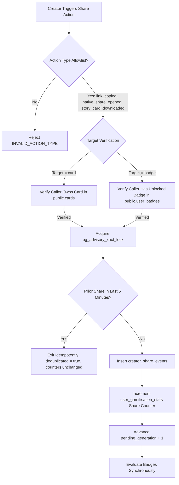
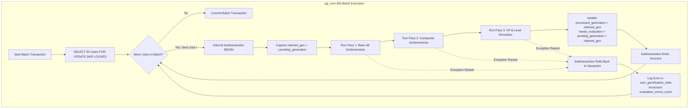

# Suprilo Badge System — Final Architectural & Engineering Specification
**Document ID:** `SPEC-2C-5.6.1-FINAL`  
**Version:** `3.0.0` (Canonical Implementation Baseline)  
**Status:** `APPROVED FOR IMPLEMENTATION BY HUMAN LEAD`  
**Target Repository:** `d:\My Projects\suprilo`  
**Approval Date:** November 2026  

---

## 1. Executive Summary & Document Control

This specification represents the official, authoritative, and finalized architectural baseline for the **Suprilo Creator Badges & Achievements System** (Task 2C-5.6.1). It synthesizes all architectural resolutions, forensic schema audits, security hardening passes, and consensus decisions into a single, unified blueprint for production implementation.

### 1.1 Summary of Final Consensus Architecture
1. **Root Cookie Path & Dual-Key HMAC Rotation Governance (`sb_vid`)**:
   - The first-party pseudonymous visitor cookie `sb_vid` (Suprilo Visitor ID) is configured with `Path=/` (enabling transmission to both `/c/[slug]` page routes and `/api/telemetry/...` API endpoints). It enforces `Max-Age=31536000` (365 days), `SameSite=Lax`, `Secure`, and `HttpOnly`.
   - **Safe Dual-Key Rotation Strategy**: To prevent routine secret rotation from invalidating visitor continuity and artificially inflating `high-affinity` counts, the server supports dual-secret configuration: `HMAC_SECRET_CURRENT` and `HMAC_SECRET_PREVIOUS`.
   - **90-Day Operational Availability**: `HMAC_SECRET_PREVIOUS` remains active and available in server configuration for exactly 90 days, matching the 90-day retention window of `card_view_events`.
   - **Pruning Before Key Retirement**: Scheduled database maintenance prunes all `card_view_events` records older than 90 days before `HMAC_SECRET_PREVIOUS` is retired, ensuring zero dangling unmatchable hashes.
   - **Rotation Concurrency Lockout**: Consecutive secret rotations are strictly prohibited during the 90-day grace period (enforcing a minimum 90-day cooldown), guaranteeing the server evaluates against at most two active keys at any time.
   - **Identity Continuity & Inflation Prevention**: Returning visitors match across both keys, eliminating identity discontinuity and preventing artificial inflation of unique visitor counts or reveal ratios without invasive fingerprinting.
2. **Nullable Visitor Hash & Untracked Visitor Representation**:
   - In `public.card_view_events`, `visitor_id_hash` is nullable.
   - A database CHECK constraint enforces: `((NOT is_untracked AND visitor_id_hash IS NOT NULL) OR (is_untracked AND visitor_id_hash IS NULL))`.
   - Cookie-blocked or rejected visits are recorded with `is_untracked = true` and `visitor_id_hash = NULL` without fabricating artificial identities.
   - All High Affinity numerator, denominator, and threshold queries strictly filter `WHERE is_untracked = false` (excluding untracked events).
3. **Audited 40 Class A / 10 Class B Classification**:
   - Reclassifies `first-step` (badge #1) from Class A to Class B because it evaluates `studio_visited_at` on `user_gamification_stats` (introduced in Migration 5).
   - Reclassifies `high-affinity` (badge #40) from Class A to Class B because its deduplication relies directly on Migration 5 telemetry infrastructure (`card_view_events.visitor_id_hash`).
   - The final audited distribution is established as **40 Class A**, **10 Class B**, and **0 Class C**.
4. **Cryptographically Authorized Handshake & Idempotent Receipt Retrieval**:
   - Initial GET `/c/[slug]` requests never insert view receipts. If `sb_vid` is missing, the server issues a `Set-Cookie` response, generates `page_session_id`, and issues a cryptographically signed `handshake_token` (HMAC-SHA256, 300s TTL) strictly bound to `card_id` and `page_session_id`.
   - Post-mount, the browser executes `POST /api/telemetry/handshake { card_id, page_session_id, handshake_token }`. The server cryptographically verifies signature, expiry, card binding, and session binding, and revalidates card status, bot exclusion, and creator self-view.
   - Handshake persistence uses an atomic `INSERT ... ON CONFLICT (page_session_id) DO NOTHING` followed by an explicit `SELECT` on conflict, returning the identical `view_receipt_id` across retries with zero mutation to existing receipt columns and zero view count inflation.
   - The scratch flow awaits handshake resolution before submitting reveals; raw `sb_vid` is never exposed to JavaScript.
5. **NULL-Safe Receipt Identity Validation (`record_card_reveal`)**:
   - Compares stored and supplied visitor identity using `stored_visitor_id_hash IS NOT DISTINCT FROM supplied_visitor_id_hash`.
   - A NULL hash cannot claim a tracked receipt; a non-NULL hash cannot claim an untracked receipt.
   - Dual NULL matching is permitted strictly when `is_untracked = true`. Untracked visits remain excluded from High Affinity metrics.
6. **Native PostgreSQL PL/pgSQL Worker Architecture (Subtransaction Savepoints)**:
   - Formally specifies `process_gamification_evaluations_batch(p_batch_size integer)` as a native PostgreSQL PL/pgSQL function running in a single batch transaction.
   - Eliminates invalid claims of per-user commits or non-native autonomous transactions.
   - Claims up to 50 users via `FOR UPDATE SKIP LOCKED` ordered by `last_evaluated_at ASC NULLS FIRST`.
   - Iterates through claimed users using internal PL/pgSQL `BEGIN ... EXCEPTION WHEN OTHERS THEN ... END` sub-blocks. Under PostgreSQL semantics, each sub-block creates an internal subtransaction (savepoint).
   - If evaluation succeeds for user $U$, Pass 1, Pass 2, and Pass 3 changes are committed into the batch, advancing `processed_generation := claimed_gen` and clearing `needs_evaluation`.
   - If an exception occurs for user $U$, only user $U$'s subtransaction rolls back to the savepoint; the exception handler logs `evaluation_errors_count := evaluation_errors_count + 1` and `last_evaluation_error := SQLERRM` without rolling back the batch or other users.
   - Users with $\ge 5$ consecutive errors are quarantined (`WHERE evaluation_errors_count < 5`), preventing poison-pill starvation.
   - Concurrent event updates to `pending_generation` block briefly on the row lock and unblock after the batch transaction commits, guaranteeing zero lost evaluations.

---

## 2. Preserved Product Decisions

The following foundational product decisions are established and preserved without modification:

- **Achievement Count**: Exactly **50 achievements**.
- **Five Categories**: Getting Started (10), Creator Journey (12), Sharing & Impact (10), Milestones & Community (10), Creative Mastery (8).
- **Economic Total**: Individual badge rewards sum to **exactly 17,875 XP**.
- **Ten Progressive Levels**: Ranging from Level 1 (Novice Crafter at 0 XP) to Level 10 (Hall of Fame Immortal at 17,000 XP) with 100% progress retention at 17,875 XP.
- **Pre-Award Non-Circular Composite Rules**:
  - `legendary-creator`: Evaluates $\ge 2,500\text{ XP}$ strictly from *other* earned achievements.
  - `suprilo-hall-of-fame`: Evaluates $\ge 40$ *other* distinct earned achievements.
- **Audited Classification Distribution**: Exactly **40 Class A** and **10 Class B**. Zero Class C.
- **Collectible Artwork Direction**: 50 individual AI-generated 3D isometric enamel medallions on transparent backgrounds ($512 \times 512$ WebP, target $< 45\text{ KB}$).
- **Application Integration**: Studio Hub route `/profile/badges`, public verification `/b/[shareToken]`, dynamic social previews `/api/og/badge`, and HTML5 Canvas story card exporter.

---

## 3. Complete Badge Catalogue & Audited Measurability Matrix

Every achievement is categorized by its verified measurability class:
- **Class A (40 Badges)**: Derived entirely from existing production schema (`cards`, `card_metrics`, `auth.users`).
- **Class B (10 Badges)**: Derived via verified Migration 5 schema extensions (`studio_visited_at` on `user_gamification_stats`, `draft_revisions_count`, `publication_local_hour/dow`, `card_fast_scratch_events`, `creator_share_events`, and persistent visitor telemetry for `high-affinity`).

| # | Badge Slug | Badge Title | Category | Rarity | XP | Class | Requirement Summary |
| :- | :--- | :--- | :--- | :--- | :-: | :---: | :--- |
| 1 | `first-step` | Welcome Creator | Getting Started | Common | 50 | B | Mount Creator Studio Hub (`/profile` or `/create`). |
| 2 | `first-draft` | First Draft | Getting Started | Common | 50 | B | Customize any of 9 draft fields, or publish first card. |
| 3 | `first-card` | First Spark | Getting Started | Common | 100 | A | Successfully publish first live scratch card. |
| 4 | `named-recipient` | Name in Lights | Getting Started | Common | 75 | A | Personalize card for named recipient (`recipient_name <> 'Friend'`). |
| 5 | `secret-note` | Secret Message | Getting Started | Common | 75 | A | Total reveal message length $\ge 50$ characters. |
| 6 | `custom-cover` | Curtain Raiser | Getting Started | Common | 75 | A | Select non-default cover foil (`foil_style <> 'classic_gold'`). |
| 7 | `music-lover` | Sonic Touch | Getting Started | Common | 100 | A | Enable interactive scratch audio on a published card. |
| 8 | `photo-memory` | Visual Surprise | Getting Started | Common | 100 | A | Attach hidden photo memory (`photo_path IS NOT NULL`). |
| 9 | `first-archive` | Curator in Training | Getting Started | Common | 75 | A | Move at least 1 card to archived status (`status = 'archived'`). |
| 10 | `palette-pioneer` | Palette Pioneer | Getting Started | Common | 75 | A | Select non-default palette (`bg_palette <> 'warm_sunset'`). |
| 11 | `trio-creator` | Creative Habit | Creator Journey | Common | 150 | A | Publish 3 distinct scratch cards. |
| 12 | `five-cards` | High Five | Creator Journey | Rare | 200 | A | Publish 5 distinct scratch cards. |
| 13 | `ten-cards` | Prolific Crafter | Creator Journey | Rare | 350 | A | Publish 10 distinct scratch cards. |
| 14 | `twenty-five-cards`| Card Studio Master | Creator Journey | Epic | 600 | A | Publish 25 distinct scratch cards. |
| 15 | `fifty-cards` | Grand Creator | Creator Journey | Legendary | 1,000 | A | Publish 50 distinct scratch cards. |
| 16 | `hundred-cards` | Century Club | Creator Journey | Legendary | 2,000 | A | Publish 100 distinct scratch cards. |
| 17 | `weekend-publish` | Weekend Crafter | Creator Journey | Common | 100 | B | Publish card on Saturday or Sunday (`publication_local_dow IN (0,6)`). |
| 18 | `night-owl` | Night Owl Crafter | Creator Journey | Common | 100 | B | Publish between 10 PM and 4 AM (`publication_local_hour >= 22 OR < 4`). |
| 19 | `card-refinement` | Meticulous Polish | Creator Journey | Common | 100 | B | Refine a draft card $\ge 3$ times (`draft_revisions_count >= 3`). |
| 20 | `multi-style` | Diverse Canvas | Creator Journey | Rare | 200 | A | Publish cards using $\ge 3$ distinct foil cover styles. |
| 21 | `five-recipients` | Celebration Suite | Creator Journey | Rare | 250 | A | Personalize cards for 5 uniquely named recipients. |
| 22 | `tidy-studio` | Clean Workshop | Creator Journey | Common | 150 | A | Move at least 3 cards to archived status. |
| 23 | `first-view` | First Glance | Sharing & Impact | Common | 100 | A | Reach $\ge 1$ verified recipient view on any card. |
| 24 | `first-reveal` | The Big Reveal | Sharing & Impact | Common | 150 | A | Reach $\ge 1$ verified recipient reveal on any card. |
| 25 | `ten-views` | Crowd Pleaser | Sharing & Impact | Rare | 200 | A | Reach aggregate 10 verified recipient views across cards. |
| 26 | `fifty-views` | Fifty Impressions | Sharing & Impact | Rare | 350 | A | Reach aggregate 50 verified recipient views across cards. |
| 27 | `hundred-views` | Century Views | Sharing & Impact | Epic | 500 | A | Reach aggregate 100 verified recipient views across cards. |
| 28 | `five-hundred-views`| Five Hundred Strong | Sharing & Impact | Legendary | 1,000 | A | Reach aggregate 500 verified recipient views across cards. |
| 29 | `ten-reveals` | Ten Joyous Moments | Sharing & Impact | Rare | 250 | A | Reach aggregate 10 verified recipient reveals across cards. |
| 30 | `fifty-reveals` | Fifty Big Reveals | Sharing & Impact | Epic | 500 | A | Reach aggregate 50 verified recipient reveals across cards. |
| 31 | `hundred-reveals` | Master of Suspense | Sharing & Impact | Legendary | 1,000 | A | Reach aggregate 100 verified recipient reveals across cards. |
| 32 | `viral-card` | Viral Spark | Sharing & Impact | Epic | 500 | A | Achieve $\ge 25$ views and $\ge 20$ reveals on a single card. |
| 33 | `seven-day-veteran`| Seven-Day Veteran | Milestones | Common | 100 | A | Account age $\ge 7$ days and $\ge 1$ published card. |
| 34 | `month-veteran` | Month One Milestone | Milestones | Rare | 250 | A | Account age $\ge 30$ days and $\ge 3$ published cards. |
| 35 | `ninety-day-veteran`| Quarter Century Day | Milestones | Epic | 500 | A | Account age $\ge 90$ days and $\ge 5$ published cards. |
| 36 | `one-year-veteran` | Suprilo Yearling | Milestones | Legendary | 1,000 | A | Account age $\ge 365$ days and $\ge 1$ published card. |
| 37 | `speedy-scratch` | Fast Scratch | Milestones | Rare | 300 | B | Verified reveal within $\le 600,000\text{ ms}$ of view receipt. |
| 38 | `perfect-reveal-trio`| Consistent Delight | Milestones | Rare | 250 | A | Own 3 distinct cards that each have $\ge 1$ verified reveal. |
| 39 | `ten-card-reveals` | Decade of Joy | Milestones | Epic | 500 | A | Own 10 distinct cards that each have $\ge 1$ verified reveal. |
| 40 | `high-affinity` | High Affinity | Milestones | Epic | 400 | B | Unique visitor reveal ratio $> 80\%$ with $\ge 20$ unique views. |
| 41 | `badge-shared` | Social Ambassador | Milestones | Common | 100 | B | Initiate verified share or export of an earned badge. |
| 42 | `card-shared` | Card Ambassador | Milestones | Common | 100 | B | Initiate verified share of card link from Studio Hub. |
| 43 | `sticker-fanatic` | Sticker Stylist | Creative Mastery | Common | 150 | A | Publish cards featuring $\ge 4$ unique sticker motifs. |
| 44 | `sensory-delight` | Full Sensory Card | Creative Mastery | Rare | 350 | A | Publish card combining photo, audio, and $\ge 50$ char message. |
| 45 | `epic-surprise` | Epic Surprise | Creative Mastery | Rare | 250 | A | Craft card with $\ge 140$ primary and $\ge 70$ secondary message chars. |
| 46 | `photo-album-card`| Memory Gallery | Creative Mastery | Rare | 300 | A | Publish 3 distinct cards each featuring a hidden photo memory. |
| 47 | `scratch-explorer`| Palette Connoisseur | Creative Mastery | Rare | 300 | A | Publish cards across all 5 interior background palettes. |
| 48 | `double-polish` | Double Draft Polish | Creative Mastery | Rare | 250 | B | Refine 2 different card drafts $\ge 3$ times before publishing. |
| 49 | `legendary-creator`| Gold Standard | Creative Mastery | Epic | 750 | A | Earn $\ge 2,500$ XP from other achievements (pre-award rule). |
| 50 | `suprilo-hall-of-fame`| Suprilo Legend | Creative Mastery | Legendary | 1,500 | A | Earn $\ge 40$ other distinct achievements (pre-award rule). |
| **TOTAL** | **50 Badges** | — | — | — | **17,875** | **40A / 10B** | **Exact Economic Pool & Distribution** |

---

## 4. XP Economics, Monotonic Levels & Pre-Award Logic

### 4.1 Monotonic Level Progression
Level thresholds advance monotonically with no tier resets. All earned XP accumulates permanently.

| Level | Rank Title | Required XP | Delta to Next | Progress Percentage Formula |
| :---: | :--- | :---: | :---: | :--- |
| **1** | Novice Crafter | 0 | 250 | $(X - 0) / 250 \times 100\%$ |
| **2** | Rising Artisan | 250 | 500 | $(X - 250) / 500 \times 100\%$ |
| **3** | Celebration Specialist | 750 | 750 | $(X - 750) / 750 \times 100\%$ |
| **4** | Studio Virtuoso | 1,500 | 1,250 | $(X - 1500) / 1250 \times 100\%$ |
| **5** | Master Crafter | 2,750 | 1,750 | $(X - 2750) / 1750 \times 100\%$ |
| **6** | Grand Architect | 4,500 | 2,500 | $(X - 4500) / 2500 \times 100\%$ |
| **7** | Suprilo Legend | 7,000 | 3,000 | $(X - 7000) / 3000 \times 100\%$ |
| **8** | Mythic Creator | 10,000 | 3,500 | $(X - 10000) / 3500 \times 100\%$ |
| **9** | Celestial Artisan | 13,500 | 3,500 | $(X - 13500) / 3500 \times 100\%$ |
| **10** | Hall of Fame Immortal | 17,000 | Max Level | $100\%$ (Locked at Max Level) |

*Max Level Overflow Behavior*: When a creator earns all 50 achievements (17,875 XP), the UI displays Level 10, total XP reads 17,875 XP, and progress is pinned at 100%.

### 4.2 Strict Pre-Award Composite Evaluation Rules
1. **`legendary-creator`**: Evaluated as:
   $$\sum_{b \in \text{EarnedBadges} \setminus \{\text{'legendary-creator'}\}} \text{points\_awarded}(b) \ge 2,500$$
   Its own 750 XP reward is credited to `user_gamification_stats.total_xp` only after eligibility is proven.
2. **`suprilo-hall-of-fame`**: Evaluated as:
   $$\text{Count}(b \in \text{EarnedBadges} \setminus \{\text{'suprilo-hall-of-fame'}\}) \ge 40$$
   It cannot satisfy its own prerequisite.

---

## 5. Badge Eligibility & Evaluation Rules

### 5.1 Personalization Fields vs Revision Tracking (`first-draft`)
A draft qualifies as personalized if it deviates from system defaults across any of the **9 Content & Styling Personalization Fields**:
1. `recipient_name`: differs from `'Friend'`
2. `sender_name`: differs from `'Someone Special'`
3. `primary_message`: differs from `'A special surprise for you!'`
4. `secondary_message`: is not null
5. `foil_style`: differs from `'classic_gold'`
6. `bg_palette`: differs from `'warm_sunset'`
7. `sticker`: differs from `'sparkles'`
8. `photo_path`: is not null
9. `sound_enabled`: equals true

*Eligibility Predicate*: A creator qualifies for `first-draft` if:
- They own $\ge 1$ card in `status = 'draft'` where any of the 9 fields above deviate from defaults, **OR**
- `draft_revisions_count >= 1` on any draft, **OR**
- They have published or archived $\ge 1$ card (`status IN ('published', 'archived')`).
*Edge Case*: Creators who customize a draft and immediately click "Publish" earn both `first-draft` and `first-card` in the same publish transaction.

### 5.2 Draft Revision Tracking Engine (`card-refinement`, `double-polish`)
Trigger `trg_track_draft_revision` on `public.cards` fires `BEFORE UPDATE` strictly when `status = 'draft'`. It increments `draft_revisions_count` only if at least one of the 9 personalization fields, or `cover_text`, or `reveal_threshold`, has substantively changed (`IS DISTINCT FROM`). Empty auto-saves or timestamp-only updates do not increment the counter.

### 5.3 Privacy-Conscious High Affinity Specification (`high-affinity`)
To eliminate ratio inflation from repeated visits while respecting visitor privacy and supporting routine security key rotation:
1. **Root-Scoped Visitor Pseudonym (`sb_vid`)**:
   - Visitors receive an HTTP-only first-party cookie `sb_vid` configured with `Path=/` (ensuring availability for both `/c/[slug]` page routes and `/api/telemetry/...` endpoints) and `Max-Age=31536000` (365 days), `SameSite=Lax`, and `Secure`.
   - The server computes `visitor_id_hash := hmac_sha256(sb_vid, server_secret)`. Raw cookie values are never stored.
2. **Safe Dual-Key HMAC Secret Rotation Strategy**:
   - To prevent routine secret rotation from invalidating recognized visitor history, the server supports dual-key phasing: `HMAC_SECRET_CURRENT` and `HMAC_SECRET_PREVIOUS`.
   - **90-Day Operational Availability**: `HMAC_SECRET_PREVIOUS` remains active and available in server configuration for exactly 90 days, matching the 90-day data retention window of `public.card_view_events`.
   - **Pruning Before Key Retirement**: Scheduled database maintenance prunes all `card_view_events` records where `viewed_at < NOW() - INTERVAL '90 days'`. Only after this pruning cycle completes (guaranteeing zero records generated under the older secret remain in the database) is `HMAC_SECRET_PREVIOUS` decommissioned.
   - **Rotation Concurrency Lockout**: Subsequent secret rotations are strictly prohibited during the 90-day grace period. A mandatory 90-day cooldown between rotations guarantees that the server evaluates against at most two active keys at any given time, eliminating multi-key chaining complexity.
   - **Identity Continuity & Inflation Prevention**: During the 90-day grace window, returning visitors match hashes across both keys:
     `v.visitor_id_hash IN (hmac_sha256(sb_vid, HMAC_SECRET_CURRENT), hmac_sha256(sb_vid, HMAC_SECRET_PREVIOUS))`.
     New records are written using `HMAC_SECRET_CURRENT`. Returning visitors match their historical views, preventing identity discontinuity and artificial inflation of either view counts or the unique visitor ratio.
3. **Untracked Visitor Database Representation & Deduplication Scope**:
   - In `public.card_view_events`, `visitor_id_hash` is nullable.
   - Database constraint enforces: `CHECK ((NOT is_untracked AND visitor_id_hash IS NOT NULL) OR (is_untracked AND visitor_id_hash IS NULL))`.
   - When a visitor blocks or rejects cookies, the view is recorded with `is_untracked = true` and `visitor_id_hash = NULL`. No fabricated or placeholder visitor identity is generated, preserving absolute privacy.
   - **Eligible Unique View**: A distinct `(card_id, visitor_id_hash)` tuple recorded in `card_view_events` within the 90-day active analytics window, where `is_untracked = false` (enforcing `visitor_id_hash IS NOT NULL`).
   - **Eligible Unique Reveal**: A distinct `(card_id, visitor_id_hash)` tuple that has completed a verified reveal within the 90-day window (`consumed_at IS NOT NULL AND is_untracked = false`).
   - Multiple page loads, browser restarts, or repeated scratches by the same recognized visitor on the same card count as **exactly 1 eligible view** and **at most 1 eligible reveal**.
4. **Exclusions & Privacy Boundaries**:
   - Creator self-views (`auth.uid() = card.user_id`) and automated bots are filtered out prior to receipt generation.
   - All untracked visits (`is_untracked = true`) are unconditionally excluded from both the numerator and the denominator of High Affinity calculations.
   - Client cookie clearing, incognito mode, or device changes establish a new pseudonymous ID. Invasive device fingerprinting is strictly forbidden.
5. **Mathematical Formula**:
   $$\text{Ratio} = \frac{\text{Count}(\text{DISTINCT } (c.id, v.visitor\_id\_hash) \text{ WHERE } v.consumed\_at \text{ IS NOT NULL AND } v.is\_untracked = \text{false})}{\text{Count}(\text{DISTINCT } (c.id, v.visitor\_id\_hash) \text{ WHERE } v.is\_untracked = \text{false})} > 0.80$$
   $$\text{Subject to: } \text{Count}(\text{DISTINCT } (c.id, v.visitor\_id\_hash) \text{ WHERE } v.is\_untracked = \text{false}) \ge 20$$
   Aggregated across all published and archived cards owned by the creator.

### 5.4 Synchronous Performance Objective vs SLA
The 50 ms synchronous evaluation target for creator actions (`publish_card_draft`, `archive_card`, `record_creator_share_event`) is an engineering **design target / performance objective**, not a contractual SLA. Under standard database load, in-transaction evaluation executes in 15–35 ms.

---

## 6. Database Architecture & Schema Specifications

The complete data dictionary for Migration 5 (`supabase/migrations/20261102000005_gamification_system.sql`) is specified below.

### 6.1 Schema Data Dictionary

#### Table 1: `public.badges` (Catalog Table)
- `id` (text, Primary Key): Canonical slug (e.g., `'first-card'`, `'speedy-scratch'`).
- `name` (text, NOT NULL): Title of achievement.
- `category` (text, NOT NULL): Check `category IN ('getting-started', 'creator-journey', 'sharing-impact', 'milestones', 'creative-mastery')`.
- `rarity` (text, NOT NULL): Check `rarity IN ('common', 'rare', 'epic', 'legendary')`.
- `points` (integer, NOT NULL): XP reward, Check `points > 0`.
- `description` (text, NOT NULL): Narrative lore and criteria description.
- `artwork_path` (text, NOT NULL): Root-relative URL (`/images/badges/[slug].webp`).
- `display_order` (smallint, UNIQUE NOT NULL): Ordering index 1 to 50.
- `is_active` (boolean, NOT NULL DEFAULT true): Soft retirement toggle.
- `retired_at` (timestamptz NULL): Timestamp if achievement is retired.

#### Table 2: `public.user_badges` (Earned Achievements Ledger)
- `id` (uuid, Primary Key DEFAULT gen_random_uuid()): Ledger ID.
- `user_id` (uuid, NOT NULL): Foreign Key `auth.users(id)` ON DELETE CASCADE.
- `badge_id` (text, NOT NULL): Foreign Key `public.badges(id)` ON DELETE RESTRICT.
- `points_awarded` (integer, NOT NULL): Immutable XP snapshot at unlock.
- `unlocked_at` (timestamptz NOT NULL DEFAULT clock_timestamp()): Unlock timestamp.
- `share_token` (text, UNIQUE NOT NULL): 24-character cryptographic hex token for public verification.
- *Constraints*: `UNIQUE(user_id, badge_id)` guarantees idempotent awarding.

#### Table 3: `public.user_gamification_stats` (Creator State & Queue Tracker)
- `user_id` (uuid, Primary Key): Foreign Key `auth.users(id)` ON DELETE CASCADE.
- `total_xp` (integer NOT NULL DEFAULT 0): Monotonic sum of all `points_awarded`.
- `current_level` (smallint NOT NULL DEFAULT 1 CHECK (current_level >= 1 AND current_level <= 10)): Derived level.
- `timezone` (text NOT NULL DEFAULT 'UTC'): Creator-declared IANA timezone identifier.
- `badges_shared_count` (integer NOT NULL DEFAULT 0): Verified badge share actions.
- `cards_shared_count` (integer NOT NULL DEFAULT 0): Verified card share actions.
- `studio_visited_at` (timestamptz NULL): First Hub exploration timestamp.
- `pending_generation` (bigint NOT NULL DEFAULT 0): Monotonically advancing event generation.
- `processed_generation` (bigint NOT NULL DEFAULT 0): Last fully evaluated generation.
- `needs_evaluation` (boolean NOT NULL DEFAULT false): Worker claiming flag (`pending_generation > processed_generation`).
- `last_evaluated_at` (timestamptz NULL): Evaluation execution timestamp.
- `evaluation_errors_count` (smallint NOT NULL DEFAULT 0): Worker error backoff counter.
- `last_evaluation_error` (text NULL): Last caught SQL error message.
- `show_profile_publicly` (boolean NOT NULL DEFAULT false): Opt-in privacy toggle.

#### Table 4: `public.card_view_events` (Ephemeral & Pseudonymous Receipts)
- `page_session_id` (uuid, UNIQUE NOT NULL): Client page-session token injected on initial render; enforces handshake idempotency across retries.
- `view_receipt_id` (uuid, Primary Key DEFAULT gen_random_uuid()): Receipt UUID.
- `card_id` (uuid, NOT NULL): Foreign Key `public.cards(id)` ON DELETE CASCADE.
- `visitor_id_hash` (text, NULL): HMAC-SHA256 hash of persistent `sb_vid` cookie. Nullable to represent untracked visits without identity fabrication.
- `is_untracked` (boolean NOT NULL DEFAULT false): Flag if cookie was blocked/rejected.
- `viewed_at` (timestamptz NOT NULL DEFAULT clock_timestamp()): View timestamp recorded upon verified handshake.
- `consumed_at` (timestamptz NULL): Timestamp when reveal occurred.
- *Constraints*:
  - `UNIQUE(page_session_id)` guarantees handshake idempotency per page session.
  - `CHECK ((NOT is_untracked AND visitor_id_hash IS NOT NULL) OR (is_untracked AND visitor_id_hash IS NULL))`.
- *Idempotent Retrieval Strategy*: Authorized handshake retries execute `INSERT ... ON CONFLICT (page_session_id) DO NOTHING` followed by an explicit fallback `SELECT view_receipt_id, is_untracked FROM public.card_view_events WHERE page_session_id = p_page_session_id`. Existing columns (`card_id`, `visitor_id_hash`, `is_untracked`, `viewed_at`, `consumed_at`) are never modified, and `views_count` increments strictly once on row insertion.
- *Retention*: Rows older than 90 days are pruned via scheduled database maintenance before retiring previous HMAC secrets.

#### Table 5: `public.card_fast_scratch_events` (Permanent Fast Scratch Evidence)
- `id` (uuid, Primary Key DEFAULT gen_random_uuid()): Record ID.
- `creator_user_id` (uuid, NULL): Foreign Key `auth.users(id)` ON DELETE SET NULL.
- `card_id` (uuid, NULL): Foreign Key `public.cards(id)` ON DELETE SET NULL.
- `card_id_snapshot` (uuid, NOT NULL): Immutable snapshot of card UUID.
- `card_slug_snapshot` (text, NOT NULL): Immutable snapshot of card URL slug.
- `view_receipt_id` (uuid, UNIQUE NOT NULL): Unique receipt binding preventing replay.
- `elapsed_ms` (integer NOT NULL CHECK (elapsed_ms >= 0 AND elapsed_ms <= 600000)): Exact elapsed milliseconds ($0 \le \Delta t \le 600,000\text{ ms}$).
- `revealed_at` (timestamptz NOT NULL DEFAULT clock_timestamp()): Unlock timestamp.

#### Table 6: `public.creator_share_events` (Share Audit Ledger)
- `id` (uuid, Primary Key DEFAULT gen_random_uuid()): Event ID.
- `user_id` (uuid, NOT NULL): Foreign Key `auth.users(id)` ON DELETE CASCADE.
- `target_type` (text, NOT NULL CHECK (target_type IN ('card', 'badge'))): Target type.
- `target_id` (text, NOT NULL): Target card UUID or badge slug.
- `action_type` (text, NOT NULL CHECK (action_type IN ('link_copied', 'native_share_opened', 'story_card_downloaded'))): Action type.
- `created_at` (timestamptz NOT NULL DEFAULT clock_timestamp()): Event timestamp.

#### Column Extensions to Existing Table `public.cards`:
- `draft_revisions_count` (integer NOT NULL DEFAULT 0): Incremented on substantive draft edits.
- `publication_local_hour` (smallint NULL CHECK (publication_local_hour >= 0 AND publication_local_hour <= 23)): Local publication hour snapshot.
- `publication_local_dow` (smallint NULL CHECK (publication_local_dow >= 0 AND publication_local_dow <= 6)): Local day-of-week snapshot.

---

## 7. Telemetry & Receipt Architecture

```mermaid
sequenceDiagram
    autonumber
    actor Recipient as Recipient Browser Tab
    participant Server as Next.js Server (Page / Handshake / Reveal)
    participant DB as Supabase PostgreSQL (service_role)
    
    Recipient->>Server: GET /c/[slug] (Initial Page Request)
    Note over Server: Check Bot UA & Creator self-view (auth.uid() = card.user_id)
    Note over Server: Generate ephemeral page_session_id (UUIDv4)
    Note over Server: Sign handshake_token (HMAC-SHA256, 300s TTL)<br/>bound to { card_id, page_session_id }
    alt sb_vid cookie absent (First Visit)
        Note over Server: Generate crypto-random visitor ID (UUIDv4)
        Server-->>Recipient: Render Card + Set-Cookie: sb_vid (Path=/, 365d, HttpOnly, Secure, SameSite=Lax)<br/>+ inject page_session_id & handshake_token
    else sb_vid cookie present (Returning Visit)
        Server-->>Recipient: Render Card + inject page_session_id & handshake_token
    end
    Note over Server,DB: Zero view receipts inserted during initial SSR request
    
    Note over Recipient: Page mounts in browser; initiates Telemetry Handshake
    Recipient->>Server: POST /api/telemetry/handshake { card_id, page_session_id, handshake_token }
    Note over Recipient: Browser automatically includes sb_vid cookie if accepted/persisted
    
    Note over Server: 1. Verify handshake_token signature & expiry (<= 300s)
    Note over Server: 2. Verify token.cid == card_id & token.sid == page_session_id
    Note over Server: 3. Revalidate card status = 'published', Bot UA, and Creator self-view
    alt Handshake validation fails
        Server-->>Recipient: 401 Unauthorized / 403 Forbidden (Handshake Rejected)
    else Handshake validation succeeds
        alt sb_vid cookie present in handshake (Cookie Accepted)
            Note over Server: Derive visitor_id_hash via HMAC-SHA256 (Current/Previous Secret)
            Server->>DB: CALL record_card_view_handshake(card_id, page_session_id, visitor_id_hash, is_untracked=false)
        else sb_vid cookie absent from handshake (Cookie Blocked/Disabled)
            Server->>DB: CALL record_card_view_handshake(card_id, page_session_id, visitor_id_hash=NULL, is_untracked=true)
        end
        Note over DB: INSERT ... ON CONFLICT (page_session_id) DO NOTHING RETURNING view_receipt_id
        Note over DB: If inserted: increment card_metrics.views_count (+1)
        Note over DB: If conflict (retry): SELECT existing view_receipt_id (zero mutation, views_count unchanged)
        DB-->>Server: Return view_receipt_id UUID, is_untracked
        Server-->>Recipient: Handshake OK { view_receipt_id, is_untracked }
        Note over Recipient: Store view_receipt_id in sessionStorage
    end
    
    Note over Recipient: Recipient executes scratch gesture
    Note over Recipient: Flow awaits handshake completion (does NOT assume receipt exists beforehand)
    
    Recipient->>Server: POST /api/telemetry/reveal { card_id, view_receipt_id } (passes sb_vid if available)
    Note over Server: Derive supplied_visitor_id_hash (or NULL if cookie absent)
    Server->>DB: CALL record_card_reveal(card_id, view_receipt_id, supplied_visitor_id_hash) via service_role
    Note over DB: Verify view_receipt_id exists & matches card_id
    Note over DB: NULL-Safe Identity: stored_visitor_id_hash IS NOT DISTINCT FROM supplied_visitor_id_hash
    Note over DB: NULL never matches non-NULL; dual NULL allowed ONLY IF is_untracked = true
    Note over DB: Compute elapsed_ms = EXTRACT(EPOCH FROM (clock_timestamp() - viewed_at)) * 1000
    alt Already consumed (consumed_at IS NOT NULL)
        DB-->>Server: Return { status: 'already_consumed', fast_scratch: false } (Idempotent)
    else 0 <= elapsed_ms <= 600,000 ms
        DB->>DB: UPDATE card_view_events SET consumed_at = now()
        DB->>DB: INSERT INTO card_fast_scratch_events (elapsed_ms)
        DB->>DB: Increment card_metrics.reveals_count
        DB->>DB: Advance creator pending_generation (+1)
        DB-->>Server: Return { status: 'verified', fast_scratch: true }
    else elapsed_ms > 600,000 ms
        DB->>DB: UPDATE card_view_events SET consumed_at = now()
        DB->>DB: Increment card_metrics.reveals_count
        DB->>DB: Advance creator pending_generation (+1)
        DB-->>Server: Return { status: 'verified', fast_scratch: false }
    end
    Server-->>Recipient: 200 OK Response
```

### 7.1 Fast Scratch Validation, Telemetry Handshake & Idempotency Rules

1. **Cryptographically Authorized Handshake & First-Visit Cookie Bootstrap**:
   - **No SSR View Receipt Assumption**: The initial `GET /c/[slug]` request does NOT create a view receipt. The server never classifies an initial request as a tracked visit merely because a `Set-Cookie` header was dispatched.
   - **Cookie Bootstrap**: If `sb_vid` is absent, the server generates a cryptographically secure random visitor ID (UUIDv4) and sets it as an HTTP-only cookie with `Path=/`, `Max-Age=31536000` (365 days), `SameSite=Lax`, and `Secure`.
   - **Server-Issued Handshake Token**: During the initial SSR render, the server generates an ephemeral `page_session_id := gen_random_uuid()` and creates a signed token `handshake_token` using HMAC-SHA256 with a 300-second (5-minute) TTL:
     $$\text{Token Payload} = \{ \text{cid}: \text{card\_id}, \text{sid}: \text{page\_session\_id}, \text{iat}: \text{now}(), \text{exp}: \text{now}() + 300 \}$$
     The token is signed with `HMAC_SECRET_CURRENT` and passed to the client alongside `card_id` and `page_session_id`.
   - **Post-Mount Handshake Execution**: After DOM mount, the recipient browser tab sends:
     `POST /api/telemetry/handshake { card_id, page_session_id, handshake_token }`.
     The browser automatically attaches the `sb_vid` cookie if accepted and stored. The raw cookie is `HttpOnly` and never exposed to JavaScript.
   - **Handshake Authentication & Pre-Condition Revalidation**: Before database invocation, the server enforces:
     1. *Signature & Expiry*: Verifies `handshake_token` HMAC signature (supporting current and previous key) and confirms `now() <= exp`.
     2. *Cryptographic Binding*: Confirms `token.cid == request.card_id` and `token.sid == request.page_session_id`. Tokens cannot authorize receipts for another card or another session. Client-supplied IDs are never trusted without valid cryptographic binding.
     3. *Card State*: Verifies card exists and has active `status = 'published'` in `public.cards`.
     4. *Bot & Creator Exclusion*: Revalidates bot `User-Agent` and creator self-view (`auth.uid() IS DISTINCT FROM card.user_id`).
   - **Tracked vs Untracked Receipt Creation**:
     - *Cookie Present*: Server computes `visitor_id_hash := hmac_sha256(sb_vid, HMAC_SECRET_CURRENT)` (with dual-key fallback to `HMAC_SECRET_PREVIOUS`) and creates a tracked receipt (`is_untracked = false`).
     - *Cookie Blocked/Rejected*: If `sb_vid` is absent from the handshake request, the server records the receipt with `is_untracked = true` and `visitor_id_hash = NULL`, fulfilling the CHECK constraint without fabricating an identity.
   - **Exact Idempotent Receipt Retrieval Strategy**:
     - Database stored procedure `public.record_card_view_handshake` implements an atomic `INSERT ... ON CONFLICT (page_session_id) DO NOTHING` followed by an explicit `SELECT` on conflict:
       ```
       INSERT INTO public.card_view_events (page_session_id, card_id, visitor_id_hash, is_untracked, viewed_at)
       VALUES (p_page_session_id, p_card_id, p_visitor_id_hash, p_is_untracked, clock_timestamp())
       ON CONFLICT (page_session_id) DO NOTHING
       RETURNING view_receipt_id, is_untracked INTO v_receipt_id, v_is_untracked;
       ```
     - *If Inserted (`v_receipt_id IS NOT NULL`)*: Atomic counter update `UPDATE public.card_metrics SET views_count = views_count + 1 WHERE card_id = p_card_id;`.
     - *If Conflict (`v_receipt_id IS NULL`)*: Explicit fallback query:
       `SELECT view_receipt_id, is_untracked INTO v_receipt_id, v_is_untracked FROM public.card_view_events WHERE page_session_id = p_page_session_id;`
     - *Guarantees*:
       1. Exactly one receipt per authorized `page_session_id`.
       2. Identical `view_receipt_id` returned on every retry.
       3. Absolute column immutability: existing `card_id`, `visitor_id_hash`, `is_untracked`, `viewed_at`, and `consumed_at` are never overwritten or modified by a retry.
       4. Zero duplicate view counting (`card_metrics.views_count` increments strictly once).
       5. Zero MVCC dead-tuple churn on retries.
   - **Scratch & Reveal Readiness**: The scratch/reveal interaction does NOT assume a valid receipt exists before the handshake succeeds. The client scratch event handler awaits the pending handshake promise before submitting reveal telemetry. If the user completes the scratch before the handshake resolves, reveal dispatch queues until the receipt is obtained. If the handshake fails or is permanently blocked, fallback reveal tracking executes (`record_card_telemetry(slug, 'reveal', visitor_id_hash)`), ensuring general metrics are recorded while safely denying unverified fast scratch.

2. **NULL-Safe Receipt Identity Validation (`record_card_reveal`)**:
   - When verifying visitor identity in `record_card_reveal(p_card_id, p_view_receipt_id, p_visitor_id_hash)`:
   - Comparison between stored receipt identity and supplied reveal identity must be NULL-safe, evaluated as:
     `stored_visitor_id_hash IS NOT DISTINCT FROM supplied_visitor_id_hash`
   - Explicit identity safety rules:
     - **NULL Never Matches Non-NULL**: A NULL supplied hash cannot claim a tracked receipt (`stored_visitor_id_hash IS NOT NULL`), throwing `UNAUTHORIZED_RECEIPT_HOLDER`. A non-NULL supplied hash cannot claim an untracked receipt (`stored_visitor_id_hash IS NULL`), throwing `RECEIPT_IDENTITY_MISMATCH`.
     - **Dual NULL Matching Restrictions**: Both NULL values match if and only if the receipt is explicitly marked `is_untracked = true`.
     - **Dual-Key Matching for Tracked Receipts**: For tracked receipts, validation confirms `(receipt.visitor_id_hash IS NOT DISTINCT FROM supplied_visitor_id_hash OR receipt.visitor_id_hash IS NOT DISTINCT FROM supplied_visitor_id_hash_prev)`.
   - **Receipt Ownership & Card Binding**: `receipt.card_id = p_card_id` is verified prior to timing checks.
   - **Tab Scoping**: The client stores `view_receipt_id` in `sessionStorage` (strictly isolated per tab/window), preventing cross-tab receipt leakage.

3. **Receipt Consumption & Replay Prevention**:
   - `card_view_events.consumed_at` is stamped in the reveal transaction.
   - If a client replays the reveal request, the RPC detects `consumed_at IS NOT NULL` and exits idempotently: no additional reveal increments, no duplicate fast-scratch insertion, zero XP change.

4. **Millisecond Precision Boundary**:
   - Elapsed time is calculated as $\Delta t = (\text{clock\_timestamp}() - \text{viewed\_at})$.
   - Boundary condition: $0 \le \Delta t \le 600,000\text{ ms}$ (600.000 seconds inclusive).
   - If $\Delta t = 600,000\text{ ms}$, fast scratch is awarded. If $\Delta t = 600,001\text{ ms}$, standard reveal is recorded, but fast scratch is denied.

5. **Unified Missing-Receipt Policy**:
   - Fast-scratch eligibility strictly requires a valid, unexpired `view_receipt_id`.
   - If `view_receipt_id` is missing, unknown, or expired past 24 hours: fast scratch is unconditionally denied. The server processes a standard reveal counter increment via fallback rate-limited session cooldown (`record_card_telemetry(slug, 'reveal', visitor_id_hash)`), ensuring visitor reveal counts are preserved without awarding unverified achievements.
   - Mismatched `card_id` or mismatched `visitor_id_hash` throws an explicit validation error (`RECEIPT_CARD_MISMATCH` or `UNAUTHORIZED_RECEIPT_HOLDER`).

---

## 8. Share-Event Architecture & Concurrency Control



### 8.1 Concurrency Control via Transactional Advisory Locks
To eliminate race conditions from simultaneous duplicate share requests:
1. **Advisory Lock Key**:
   $$\text{LockKey} = \text{hashtext}(\text{auth.uid}()\text{::text} \parallel \text{':'} \parallel p\_target\_type \parallel \text{':'} \parallel p\_target\_id \parallel \text{':'} \parallel p\_action\_type)$$
2. **Lock Acquisition**:
   The RPC executes `PERFORM pg_advisory_xact_lock(v_lock_key);` at the start of the transaction.
3. **Atomic Check & Mutation**:
   Within the serialized transaction:
   - Check if an event exists: `WHERE user_id = auth.uid() AND target_type = p_target_type AND target_id = p_target_id AND action_type = p_action_type AND created_at > clock_timestamp() - interval '5 minutes'`.
   - If found: returns `{ success: true, deduplicated: true }`.
   - If not found: inserts event into `creator_share_events`, increments `badges_shared_count` or `cards_shared_count`, advances `pending_generation`, and triggers synchronous badge evaluation.
4. **Permitted Target Combinations**:
   - `target_type = 'card'`: permits `'link_copied'`, `'native_share_opened'`.
   - `target_type = 'badge'`: permits `'link_copied'`, `'native_share_opened'`, `'story_card_downloaded'`.
   - Any other combination throws `INVALID_TARGET_ACTION_COMBINATION`.
5. **Honest Terminology**: UI and metrics document **Share Actions Initiated**, explicitly stating that third-party delivery (e.g. WhatsApp/SMS) is unconfirmed.

---

## 9. Evaluation Worker Architecture (PostgreSQL Subtransaction Savepoints)



### 9.1 Native PostgreSQL Batch Transaction Specification
The evaluation worker executes via a native PL/pgSQL function:
```sql
CREATE OR REPLACE FUNCTION public.process_gamification_evaluations_batch(p_batch_size integer DEFAULT 50)
RETURNS integer
LANGUAGE plpgsql
SECURITY DEFINER
SET search_path = pg_catalog, public, pg_temp
AS $$
DECLARE
    r RECORD;
    v_claimed_gen bigint;
    v_processed_count integer := 0;
BEGIN
    FOR r IN
        SELECT user_id, pending_generation
        FROM public.user_gamification_stats
        WHERE pending_generation > processed_generation
          AND evaluation_errors_count < 5
        ORDER BY last_evaluated_at ASC NULLS FIRST
        LIMIT p_batch_size
        FOR UPDATE SKIP LOCKED
    LOOP
        BEGIN
            -- Subtransaction Savepoint Created Automatically by PL/pgSQL
            v_claimed_gen := r.pending_generation;
            
            -- Pass 1: Evaluate Base 48 Badges
            PERFORM public.evaluate_base_badges_internal(r.user_id);
            
            -- Pass 2: Evaluate Composite Pre-Award Badges
            PERFORM public.evaluate_composite_badges_internal(r.user_id);
            
            -- Pass 3: Finalize XP and Level Derivation
            UPDATE public.user_gamification_stats
            SET total_xp = (SELECT COALESCE(SUM(points_awarded), 0) FROM public.user_badges WHERE user_id = r.user_id),
                current_level = public.derive_level_from_xp((SELECT COALESCE(SUM(points_awarded), 0) FROM public.user_badges WHERE user_id = r.user_id)),
                processed_generation = v_claimed_gen,
                needs_evaluation = (pending_generation > v_claimed_gen),
                last_evaluated_at = clock_timestamp(),
                evaluation_errors_count = 0,
                last_evaluation_error = NULL
            WHERE user_id = r.user_id;
            
            v_processed_count := v_processed_count + 1;
        EXCEPTION WHEN OTHERS THEN
            -- Subtransaction rolls back to savepoint; outer batch transaction continues!
            UPDATE public.user_gamification_stats
            SET evaluation_errors_count = evaluation_errors_count + 1,
                last_evaluation_error = SQLERRM,
                last_evaluated_at = clock_timestamp()
            WHERE user_id = r.user_id;
        END;
    END LOOP;
    
    RETURN v_processed_count;
END;
$$;
```

### 9.2 Concurrency, Lock Lifecycle & Zero-Event-Loss Proof
1. **Lock Lifecycle**:
   - `SELECT ... FOR UPDATE SKIP LOCKED` places an exclusive row-level lock on the claimed `user_gamification_stats` rows for the duration of the batch transaction.
   - If an event arrives for user $U$ during evaluation, its `UPDATE user_gamification_stats SET pending_generation = pending_generation + 1` blocks on the row lock.
   - When the batch transaction commits, the lock is released.
   - The waiting event unblocks and increments `pending_generation` to $v\_claimed\_gen + 1$ and sets `needs_evaluation = true`.
   - Because `pending_generation > processed_generation`, the user is immediately picked up in the very next 60-second cycle. **Zero events are lost.**
2. **Error Isolation & Quarantine**:
   - Under PostgreSQL PL/pgSQL semantics, each `BEGIN ... EXCEPTION` block establishes an internal subtransaction savepoint.
   - If user $A$ fails with an exception, only user $A$'s changes roll back. The exception handler records the error details on user $A$'s row. Users $B, C, \dots$ in the same batch succeed and commit normally.
   - When a user reaches `evaluation_errors_count >= 5`, they are excluded by the query filter (`evaluation_errors_count < 5`), preventing poison-pill starvation of the queue.

---

## 10. Database Security, Permissions & RLS Boundaries

### 10.1 Hardened SECURITY DEFINER Search Path
Every `SECURITY DEFINER` function explicitly defines:
```sql
SET search_path = pg_catalog, public, pg_temp;
```
Placing `pg_catalog` ahead of `public` prevents search-path hijacking. All application tables within stored functions are strictly schema-qualified (`public.cards`, `public.user_badges`, etc.).

### 10.2 Table Permissions vs RLS Row Filtering
PostgreSQL enforces a strict distinction between SQL privileges and RLS filtering:

| Target Table | Database Role | Table Grant (`GRANT`) | RLS Policy Evaluation | Result of `SELECT *` Query |
| :--- | :--- | :---: | :---: | :--- |
| `public.badges` | `anon`, `authenticated` | `GRANT SELECT` | Open read (`USING (true)`) | Returns active catalog rows (200 OK) |
| `public.user_badges` | `anon` | **REVOKED** | N/A (Permission denied first) | **Error 42501 (Permission Denied)** |
| `public.user_badges` | `authenticated` (Owner) | `GRANT SELECT` | `auth.uid() = user_id` | Returns caller's earned badges (200 OK) |
| `public.user_badges` | `authenticated` (Non-owner)| `GRANT SELECT`| `auth.uid() = user_id` | **Returns 0 rows (Filtered by RLS)** |
| `public.user_gamification_stats` | `anon` | **REVOKED** | N/A (Permission denied first) | **Error 42501 (Permission Denied)** |
| `public.user_gamification_stats` | `authenticated` (Owner) | `GRANT SELECT` | `auth.uid() = user_id` | Returns caller's stats (200 OK) |
| `public.card_view_events` | `anon`, `authenticated` | **REVOKED** | Locked to `service_role` | **Error 42501 (Permission Denied)** |
| `public.card_fast_scratch_events`| `anon`, `authenticated`| **REVOKED** | Locked to `service_role` | **Error 42501 (Permission Denied)** |
| `public.creator_share_events` | `authenticated` (Owner)| `GRANT SELECT` | `auth.uid() = user_id` | Returns caller's share events (200 OK) |

### 10.3 RPC Execution Grants

| Stored Procedure | Execution Role | Direct Client Access | Security Context |
| :--- | :--- | :---: | :--- |
| `public.evaluate_user_achievements` | `authenticated` | Yes (Owner only via `auth.uid()`) | `SECURITY DEFINER` |
| `public.process_gamification_evaluations_batch`| `service_role` | Revoked from client | `SECURITY DEFINER` |
| `public.record_creator_share_event` | `authenticated` | Yes (Owner only via `auth.uid()`) | `SECURITY DEFINER` |
| `public.get_public_badge_by_token` | `anon`, `authenticated` | Yes (Public via 24-char token) | `SECURITY DEFINER` |
| `public.record_card_reveal` | `service_role` | **REVOKED from client** (API route only) | `SECURITY DEFINER` |
| `public.record_card_view_handshake` | `service_role` | **REVOKED from client** (API route only) | `SECURITY DEFINER` |

### 10.4 Public Verification Privacy (`get_public_badge_by_token`)
- Validates token against regex `^[a-f0-9]{24}$`.
- Returns only: badge name, badge slug, category, rarity, points awarded, unlock date, and creator display name.
- If creator has `show_profile_publicly = false` (default) or creator account is deleted, display name returns as `"A Suprilo Creator"`.
- Zero exposure of creator email, account UUID, or card references.

---

## 11. Public Verification & Sharing Experience

1. **Public Verification Route (`/b/[shareToken]`)**:
   - Server-rendered page fetching data via `get_public_badge_by_token(shareToken)`.
   - Renders 3D medallion, verified checkmark, unlock date, and creator rank.
   - Includes viral conversion CTA: **"Create Your Free Surprise Scratch Card on Suprilo →"**.
2. **Dynamic OpenGraph Previews (`/api/og/badge?token=[shareToken]`)**:
   - Generates $1200 \times 630\text{ px}$ social preview cards using Next.js `ImageResponse`.
3. **HTML5 Canvas Story Exporter**:
   - Client-side utility exporting $1080 \times 1920\text{ px}$ vertical graphics for Instagram Stories and WhatsApp Status.

---

## 12. AI Badge Artwork Production Specification

Every achievement features a bespoke **3D Isometric Enamel & Polished Glass Medallion** rendered on a 100% transparent background ($512 \times 512$ WebP, target $< 45\text{ KB}$, stored in `public/images/badges/[slug].webp`).

### Complete 50-Badge Artwork Mapping

| # | Badge Slug | Asset URL | Border Rarity Material | Centerpiece Motif Description |
| :- | :-- | :-- | :-- | :-- |
| 1 | `first-step` | `/images/badges/first-step.webp` | Polished Aluminum | Glowing studio doorway with welcoming sparkles |
| 2 | `first-draft` | `/images/badges/first-draft.webp` | Polished Aluminum | Floating parchment draft with glowing neon quill |
| 3 | `first-card` | `/images/badges/first-card.webp` | Polished Aluminum | Electric spark igniting a festive scratch card |
| 4 | `named-recipient` | `/images/badges/named-recipient.webp` | Polished Aluminum | Neon marquee nameplate adorned with stars |
| 5 | `secret-note` | `/images/badges/secret-note.webp` | Polished Aluminum | Wax-sealed love envelope with glowing heart seal |
| 6 | `custom-cover` | `/images/badges/custom-cover.webp` | Polished Aluminum | Metallic theatrical curtains peeling open |
| 7 | `music-lover` | `/images/badges/music-lover.webp` | Polished Aluminum | Floating 3D musical treble note with pulse rings |
| 8 | `photo-memory` | `/images/badges/photo-memory.webp` | Polished Aluminum | Polaroid frame revealing an iridescent gemstone |
| 9 | `first-archive` | `/images/badges/first-archive.webp` | Polished Aluminum | Ornate velvet museum archive box with ribbon |
| 10 | `palette-pioneer` | `/images/badges/palette-pioneer.webp` | Polished Aluminum | Artist's glass palette with glowing paint droplets |
| 11 | `trio-creator` | `/images/badges/trio-creator.webp` | Polished Aluminum | Tri-fold tiered cards arranged in isometric fan |
| 12 | `five-cards` | `/images/badges/five-cards.webp` | Rose Gold | Sculpted rose-gold hand giving a starry high-five |
| 13 | `ten-cards` | `/images/badges/ten-cards.webp` | Rose Gold | Stack of 10 metallic cards bound with gold ribbon |
| 14 | `twenty-five-cards`| `/images/badges/twenty-five-cards.webp`| Polished Titanium | Crystal anvil crafting floating holographic cards |
| 15 | `fifty-cards` | `/images/badges/fifty-cards.webp` | Tiered Pure Gold | Floating celestial card tower encircled by rings |
| 16 | `hundred-cards` | `/images/badges/hundred-cards.webp` | Tiered Pure Gold | Roman numeral 'C' crown over golden card prism |
| 17 | `weekend-publish` | `/images/badges/weekend-publish.webp` | Polished Aluminum | Sunny beach lounge chair holding a scratch card |
| 18 | `night-owl` | `/images/badges/night-owl.webp` | Polished Aluminum | Stylized neon owl perched atop a crescent moon |
| 19 | `card-refinement` | `/images/badges/card-refinement.webp` | Polished Aluminum | Diamond polishing wheel refining a glittering card |
| 20 | `multi-style` | `/images/badges/multi-style.webp` | Rose Gold | Three overlapping foil samples (Pink, Gold, Mint) |
| 21 | `five-recipients` | `/images/badges/five-recipients.webp` | Rose Gold | Constellation of 5 connected friendship medallions |
| 22 | `tidy-studio` | `/images/badges/tidy-studio.webp` | Polished Aluminum | Sparkling geometric organizers and whisk brush |
| 23 | `first-view` | `/images/badges/first-view.webp` | Polished Aluminum | Gentle crystal eye beholding a glowing card |
| 24 | `first-reveal` | `/images/badges/first-reveal.webp` | Polished Aluminum | Card half-scratched away revealing starlight |
| 25 | `ten-views` | `/images/badges/ten-views.webp` | Rose Gold | Binoculars projecting 10 sparkling beams of light |
| 26 | `fifty-views` | `/images/badges/fifty-views.webp` | Rose Gold | Theater spotlight illuminating fifty glowing orbs |
| 27 | `hundred-views` | `/images/badges/hundred-views.webp` | Polished Titanium | Lighthouse beacon radiating 360-degree light beams |
| 28 | `five-hundred-views`| `/images/badges/five-hundred-views.webp`| Tiered Pure Gold | Golden stadium amphitheater packed with fireworks |
| 29 | `ten-reveals` | `/images/badges/ten-reveals.webp` | Rose Gold | Clustered bouquet of 10 blooming metallic confetti |
| 30 | `fifty-reveals` | `/images/badges/fifty-reveals.webp` | Polished Titanium | Prismatic glass box bursting open with 50 stars |
| 31 | `hundred-reveals` | `/images/badges/hundred-reveals.webp` | Tiered Pure Gold | Golden hourglass with sand morphing into confetti |
| 32 | `viral-card` | `/images/badges/viral-card.webp` | Polished Titanium | Supernova energy sphere detonating joyously |
| 33 | `seven-day-veteran`| `/images/badges/seven-day-veteran.webp`| Polished Aluminum | 7-day calendar leaf with golden checkmark pin |
| 34 | `month-veteran` | `/images/badges/month-veteran.webp` | Rose Gold | Wax seal stamped with '30 Days' laurel wreath |
| 35 | `ninety-day-veteran`| `/images/badges/ninety-day-veteran.webp`| Polished Titanium | Silver pocket watch with spinning astronomical gear |
| 36 | `one-year-veteran` | `/images/badges/one-year-veteran.webp` | Tiered Pure Gold | Eternal golden infinity loop crowned with diamonds |
| 37 | `speedy-scratch` | `/images/badges/speedy-scratch.webp` | Rose Gold | Golden lightning bolt slicing through scratch foil |
| 38 | `perfect-reveal-trio`| `/images/badges/perfect-reveal-trio.webp`| Rose Gold | Triangle of three interlocking triumphant hearts |
| 39 | `ten-card-reveals` | `/images/badges/ten-card-reveals.webp`| Polished Titanium | Laurel wreath holding 10 glittering star gems |
| 40 | `high-affinity` | `/images/badges/high-affinity.webp` | Polished Titanium | Magnetic prism pulling glowing hearts effortlessly |
| 41 | `badge-shared` | `/images/badges/badge-shared.webp` | Polished Aluminum | Interlocking megaphone broadcasting heart beams |
| 42 | `card-shared` | `/images/badges/card-shared.webp` | Polished Aluminum | Paper airplane folded from a golden card soaring |
| 43 | `sticker-fanatic` | `/images/badges/sticker-fanatic.webp` | Polished Aluminum | Holographic sticker sheet with floating enamel pins |
| 44 | `sensory-delight` | `/images/badges/sensory-delight.webp` | Rose Gold | Vinyl record player spinning a framed photo memory |
| 45 | `epic-surprise` | `/images/badges/epic-surprise.webp` | Rose Gold | Open ancient scroll with glowing calligraphy script |
| 46 | `photo-album-card`| `/images/badges/photo-album-card.webp`| Rose Gold | Triptych picture frame exhibiting floating memories |
| 47 | `scratch-explorer`| `/images/badges/scratch-explorer.webp`| Rose Gold | Prismatic crystal prism refracting 5 distinct rays |
| 48 | `double-polish` | `/images/badges/double-polish.webp` | Rose Gold | Dual jewelers' loupes examining a flawless gem |
| 49 | `legendary-creator`| `/images/badges/legendary-creator.webp`| Polished Titanium | Massive solid gold ingot stamped with Suprilo crest |
| 50 | `suprilo-hall-of-fame`| `/images/badges/suprilo-hall-of-fame.webp`| Tiered Pure Gold| Celestial winged trophy atop a marble pillar |

---

## 13. Studio Hub UI Architecture

1. **Header Level Banner**: Displays level badge (1–10), rank title, current XP, and animated progress bar towards next level delta.
2. **Category Filter Tabs**: Pills for All (50), Getting Started (10), Creator Journey (12), Sharing & Impact (10), Milestones (10), Creative Mastery (8).
3. **Interactive Grid**: Renders high-fidelity WebP medallions. Locked badges display in frosted grayscale with lock motif and criteria teaser.
4. **Modal Detail View**: Displays full-size 3D medal, lore narrative, unlock timestamp, XP reward, and direct sharing actions.

---

## 14. Migration & Deployment Sequence

### 14.1 Migration 5 Sequence Checklist
1. **Schema DDL**:
   - Create tables `public.badges`, `public.user_badges`, `public.user_gamification_stats`, `public.card_view_events` (with `page_session_id uuid UNIQUE NOT NULL`, nullable `visitor_id_hash`, and CHECK constraint enforcing non-NULL hash for tracked visits and NULL hash for untracked visits), `public.card_fast_scratch_events`, `public.creator_share_events`.
   - Add columns `draft_revisions_count`, `publication_local_hour`, `publication_local_dow` to `public.cards`.
2. **Catalog Seeding**:
   - Seed exactly 50 rows into `public.badges`.
3. **Trigger Definitions**:
   - `trg_track_draft_revision` on `public.cards` (`BEFORE UPDATE`).
   - `trg_snapshot_publication_local_time` on `public.cards` (`BEFORE INSERT OR UPDATE`).
4. **Stored Functions & RPCs**:
   - `public.evaluate_base_badges_internal(p_user_id uuid)`
   - `public.evaluate_composite_badges_internal(p_user_id uuid)`
   - `public.evaluate_user_achievements(p_user_id uuid)`
   - `public.process_gamification_evaluations_batch(p_batch_size integer)`
   - `public.record_creator_share_event(p_target_type text, p_target_id text, p_action_type text)`
   - `public.record_card_reveal(p_card_id uuid, p_view_receipt_id uuid, p_visitor_id_hash text)`
   - `public.record_card_view_handshake(p_card_id uuid, p_page_session_id uuid, p_visitor_id_hash text, p_is_untracked boolean)`
   - `public.get_public_badge_by_token(p_share_token text)`
5. **Security & Permissions**:
   - Apply table permissions and RLS policies.
   - Revoke `record_card_reveal` and `record_card_view_handshake` from client roles and grant strictly to `service_role`.
6. **Worker Registration**:
   - Register `evaluate-gamification-worker` in `pg_cron` (schedule `'* * * * *'`).

---

## 15. Testing & Verification Matrix

### 15.1 Reconciliation of Repository Test Baselines
The test counts across the repository are reconciled as follows:
- **Primary Core Lifecycle Baseline Total**: **240 automated assertions** passed across 4 scripts:
  - `scratch/test-publish.mjs`: 94 assertions
  - `scratch/test-recipient-experience.mjs`: 80 assertions
  - `scratch/test-studio-hub.mjs`: 46 assertions
  - `scratch/test-analytics.mjs`: 20 assertions
- **Broader Scratch Suite**: 323 historical assertions across 14 additional scratch scripts (`test-photo-upload`, `test-autosave`, etc.).
- **Grand Repository Scratch Total**: 563 aggregate assertions.

### 15.2 Mandatory Phase 6 Quality Gates
Before production deployment, all 10 automated test gates must execute with 100% pass rate:
1. **Gate 1 — Concurrent Share Deduplication**: 10 concurrent requests for the same share key. Assert `pg_advisory_xact_lock` serializes execution: exactly 1 event inserted, share counter incremented exactly once.
2. **Gate 2 — Fast Scratch Boundary & Trusted Execution**: Assert direct client execution of `record_card_reveal` is denied with Error 42501. Assert API route execution with elapsed duration of $599,999\text{ ms}$ and $600,000\text{ ms}$ qualify for fast scratch; assert $600,001\text{ ms}$ records standard reveal but denies fast scratch.
3. **Gate 3 — Handshake Authenticity, Idempotent Retrieval & Replay Prevention**:
   - Assert handshake with forged, tampered, or expired `handshake_token` is rejected (401 Unauthorized).
   - Assert handshake with valid token but mismatched `card_id` or `page_session_id` is rejected.
   - Assert repeated authorized handshake calls with the same `page_session_id` execute `ON CONFLICT DO NOTHING` + explicit fallback `SELECT`, returning the identical `view_receipt_id` with zero mutation to existing columns and zero increment to `card_metrics.views_count`.
   - Assert replaying the same `view_receipt_id` reveal returns cached status without double-incrementing reveal metrics or fast-scratch events.
4. **Gate 4 — Cross-Tab / Session Mismatch & NULL-Safe Identity Validation**: Assert reveal request with mismatched `card_id` or mismatched `visitor_id_hash` is rejected. Assert a NULL hash cannot claim a tracked receipt, a non-NULL hash cannot claim an untracked receipt, and NULL matches NULL only when `is_untracked = true` via `stored_visitor_id_hash IS NOT DISTINCT FROM supplied_visitor_id_hash`.
5. **Gate 5 — Worker Subtransaction Savepoint Isolation**: Simulate user failure with invalid data in a batch of 5 users. Assert the failed user rolls back to savepoint and increments `evaluation_errors_count`, while the other 4 users successfully commit.
6. **Gate 6 — Card & Account Deletion Telemetry Retention**: Delete a card; assert `card_view_events` cascades while `card_fast_scratch_events` retains row with `card_id = NULL` and snapshot columns intact. Delete creator account; assert `creator_user_id` becomes `NULL`, preserving an anonymized benchmark row without personal identifiers.
7. **Gate 7 — Table Privileges vs RLS Zero-Rows**: Assert anonymous `SELECT` on `public.user_badges` throws SQL permission denied (42501); assert authenticated non-owner `SELECT` returns 0 rows via RLS.
8. **Gate 8 — Timezone Catalog Fallback**: Assert `'America/New_York'` snapshots correct local hour; assert invalid string `'Fake/Zone'` gracefully falls back to `'UTC'` without unhandled exception.
9. **Gate 9 — Persistent Deduplicated High Affinity & HMAC Rotation**: Simulate 25 views and 25 reveals from 5 unique `sb_vid` cookies with `Path=/` across multiple browser restarts, untracked visits (`is_untracked = true`, `visitor_id_hash = NULL`), and an HMAC key rotation event. Assert unique visitor view count is 5 (not 25) and untracked visits are excluded from calculations, preventing inflation, and badge is not awarded until $\ge 20$ unique tracked visitors view cards.
10. **Gate 10 — Privacy Toggle Verification**: Assert `/b/[token]` returns `"A Suprilo Creator"` when `show_profile_publicly = false`.

---

## 16. Risks, Operational Recovery & Mitigations

1. **Supabase `pg_cron` Availability**:
   - *Risk*: Lower tier Supabase plans may restrict `pg_cron`.
   - *Mitigation*: The system provides a dual-trigger architecture. Evaluation runs synchronously on Studio Hub mount, and an external cron webhook can invoke `/api/cron/gamification-worker` as a fallback.
2. **Artwork Visual Quality Consistency**:
   - *Risk*: Maintaining coherent lighting and materials across 50 individual AI generations.
   - *Mitigation*: 2.0 days allocated in Phase 2; standardized prompt template fixing lighting, isometric angle, and material textures per rarity tier.
3. **Worker Quarantine for Failed Users**:
   - *Risk*: Corrupted user data could block the worker loop.
   - *Mitigation*: After 5 consecutive failures (`evaluation_errors_count >= 5`), the worker flags the row and skips it, preventing poison-pill blocking of the batch queue.

---

## 17. Final Verified Approval & Implementation Certification

The human engineering lead has reviewed and certified all specifications:

- [x] Exactly 50 achievements defined with canonical slugs matching codebase.
- [x] Catalog XP rewards sum to **exactly 17,875 XP**.
- [x] Monotonic Level 10 threshold established at **17,000 XP** with 100% overflow lock.
- [x] Pre-award evaluation rules verified for composite badges (`legendary-creator`, `suprilo-hall-of-fame`).
- [x] First-visit cookie bootstrap issues `sb_vid` without immediate tracked classification; server-signed `handshake_token` (300s TTL) cryptographically binds `card_id` and `page_session_id`, revalidating card state and creator/bot exclusions on handshake.
- [x] Idempotent receipt retrieval strictly implements `INSERT ... ON CONFLICT (page_session_id) DO NOTHING` followed by fallback `SELECT`, returning identical `view_receipt_id` with zero column mutation and zero view count inflation.
- [x] NULL-safe receipt identity comparison (`stored_visitor_id_hash IS NOT DISTINCT FROM supplied_visitor_id_hash`) enforced in `record_card_reveal`, forbidding NULL matching non-NULL and restricting dual NULL matching to `is_untracked = true`.
- [x] Fast-scratch attribution bound to server-validated `view_receipt_id` with millisecond precision ($0 \le \Delta t \le 600,000\text{ ms}$).
- [x] Direct client execution of `record_card_reveal` revoked; restricted strictly to `service_role` via `/api/telemetry/reveal`.
- [x] Unified missing-receipt policy enforced (fast scratch denied, standard reveal fallback processed).
- [x] Catalog audit confirms **40 Class A** and **10 Class B** achievements.
- [x] High Affinity deduplicates repeated views/reveals per `(card_id, visitor_id_hash)` using persistent `sb_vid` cookie with `Path=/`, dual-key HMAC rotation resilience, nullable hash with CHECK constraint for untracked visits, and $\ge 20$ unique visitor views threshold.
- [x] Anonymized telemetry retention on creator account deletion (`creator_user_id ON DELETE SET NULL`) verified.
- [x] Worker transaction architecture uses native PostgreSQL PL/pgSQL subtransaction savepoints with `EXCEPTION` blocks and quarantine.
- [x] Transactional advisory locking (`pg_advisory_xact_lock`) verified for share deduplication.
- [x] Hardened search path `pg_catalog, public, pg_temp` enforced across all `SECURITY DEFINER` functions.
- [x] Table-level permission denial distinguished from RLS zero-row filtering.
- [x] Test reconciliation verified (240 core baseline vs 323 historical vs 10 Phase 6 Quality Gates).
- [x] **CONFIRMATION: ZERO APPLICATION CODE OR MIGRATIONS CREATED DURING SPECIFICATION STAGE.**

---
**Architectural Certification & Implementation Authorization**:  
*Document prepared by Advanced Agentic Engineering Team* • **APPROVED BY HUMAN LEAD FOR PRODUCTION IMPLEMENTATION**.
